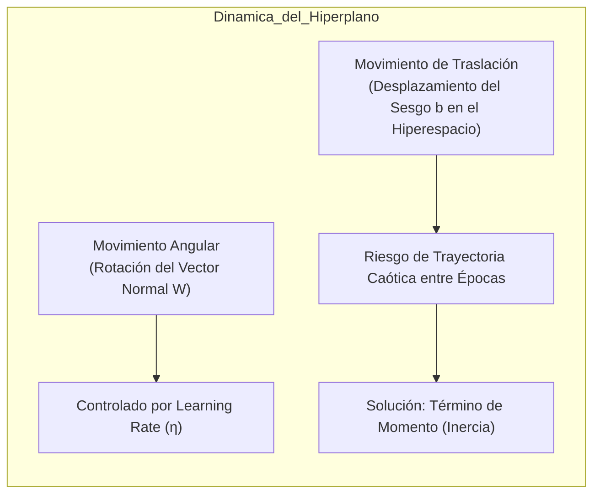
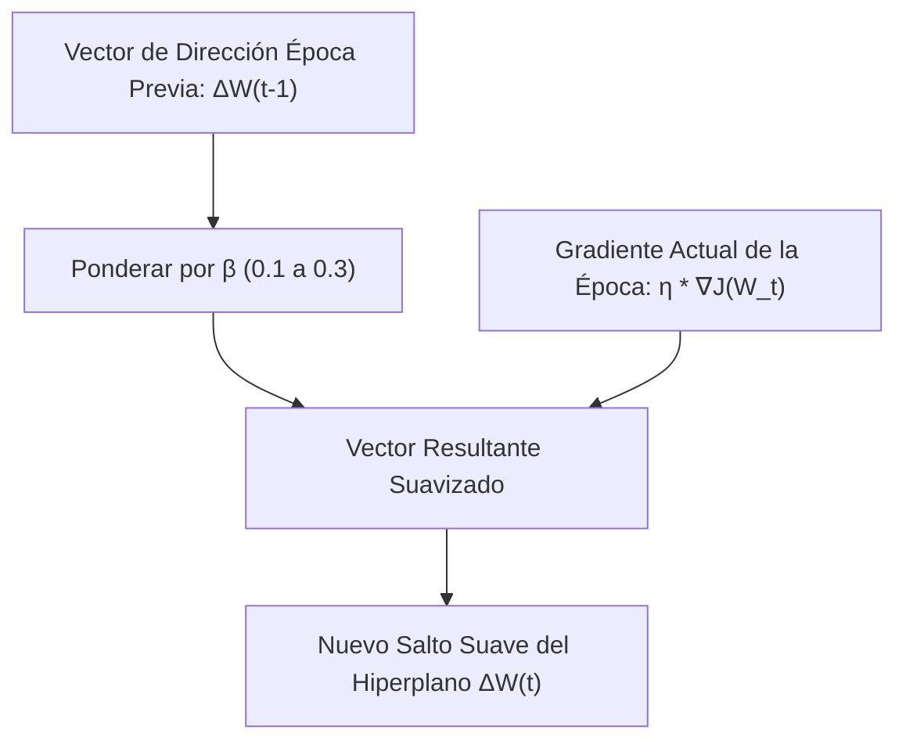
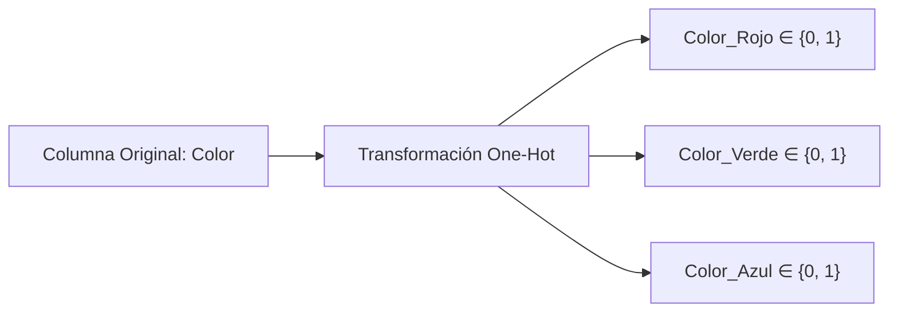
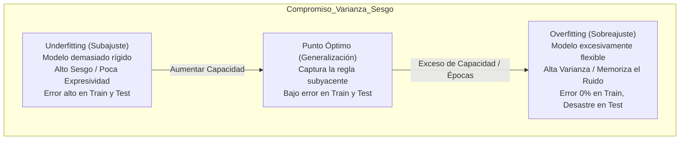
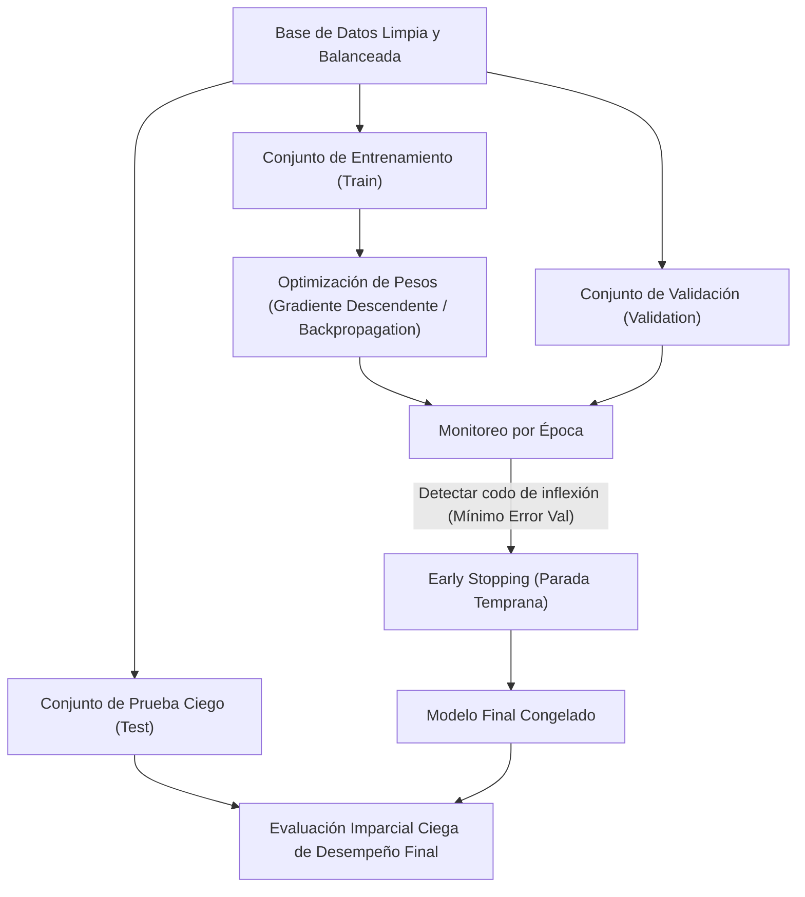

# Dinámica del Hiperplano con Momento, Preprocesamiento para Redes, Sobreajuste y Partición de Datos
*Lunes, 28 de septiembre de 2026*

## Conexiones
- Nota anterior: [[15. Redes Neuronales Multicapa (MLP) y Algoritmo de Propagación Hacia Atrás (Backpropagation)]]
- Calibración de pesos y tasa de aprendizaje: [[14. Algoritmo de Entrenamiento del Perceptrón, Regla de Aprendizaje y Calibración de Pesos]]
- Detección de outliers y distancias en el hiperespacio: [[11. Detección de Outliers Multivariados, EDA con Profiling, KNN y DBSCAN]]
- Muestreo, estabilidad y cobertura de datos: [[4. Población, Muestreo, Train-Test y Cobertura Convexa de Patrones]]

---

## Conceptos Clave
- **Movimiento Angular vs. Traslación del Hiperplano:** La tasa de aprendizaje ($\eta$) controla la magnitud del paso, pero no previene que el vector de traslación oscile caóticamente entre épocas cuando busca la zona de convergencia.
- **Término de Momento (Momentum $\beta$):** Inyecta memoria física e inercia sumando una fracción constante ($\beta \in [0.1, 0.3]$) de la dirección de la época inmediatamente anterior ($t-1$), suavizando giros bruscos y acelerando la convergencia estable.
- **Preprocesamiento Obligatorio para Redes:** Como cada neurona calcula una suma ponderada $\sum w_i x_i + b$, atributos con escalas numéricas gigantescas dominan y ahogan a los pequeños, deformando el gradiente.
- **Min-Max vs. Z-Score:** Min-Max comprime a $[0, 1]$ pero es vulnerable a outliers y sesgos de frecuencia (aplasta los datos si hay un extremo). Z-score centra en $\mu=0$ con $\sigma=1$, preservando la campana probabilística y estabilidad si ya se limpiaron outliers.
- **Codificación Categórica (One-Hot Encoding):** Las redes neuronales solo operan en espacios euclidianos continuos. El orden arbitrario de strings distorsiona distancias si se usa Label Encoding; One-Hot Encoding crea $K$ ejes binarios ortogonales.
- **Peligro del Sobreajuste (Overfitting):** Una red con excesiva capacidad expresiva (muchas neuronas y capas) memoriza particularidades y ruido del conjunto de entrenamiento en vez de generalizar la regla poblacional.
- **Tríada Train - Validation - Test y Parada Temprana (*Early Stopping*):** El error de validación es el único termómetro para detectar cuándo el modelo abandona el *underfitting* y entra al *overfitting*, marcando el punto óptimo de parada antes de evaluar con el conjunto de prueba ciego (*test*).

---

## 1. Dinámica del Hiperplano en el Hiperespacio: Movimiento Angular vs. Traslación

En las sesiones previas analizamos cómo el Perceptrón y las redes multicapa separan clases mediante hiperplanos en un hiperespacio $\mathbb{R}^d$.



### 1.1. El problema del movimiento caótico entre épocas:
1. Al iniciar el entrenamiento, los pesos se generan aleatoriamente, situando el hiperplano en una posición inicial arbitraria.
2. La posición ideal (la zona de máxima separación o mínimo error global) es **desconocida a priori** para el algoritmo.
3. En cada época, la red calcula el gradiente del error acumulado y traslada el hiperplano.
4. Sin control de dirección, el hiperplano salta erráticamente de un cuadrante a otro, dando "bandazos" en zigzag. Aunque el tamaño de paso se reduzca mediante el decaimiento de $\eta$, los cambios bruscos de orientación retrasan o impiden la convergencia.

---

## 2. El Término de Momento (*Momentum*): Inercia y Suavizado

Para resolver las oscilaciones y el movimiento caótico, se inyecta un concepto inspirado en la mecánica clásica: **el momento o inercia**.

> **Analogía Didáctica (La Bola Pesada Rodando):**  
> Imagina una canica ligera en una colina rocosa: ante cada pequeño bache rebota bruscamente en cualquier dirección. En cambio, una bola de boliche pesada rodando cuesta abajo acumula inercia: absorbe los pequeños tropiezos y mantiene su rumbo general hacia el valle. El momento actúa exactamente como esa inercia sobre el hiperplano.



### 2.1. Formulación Matemática de la Regla con Momento:
La actualización de pesos en la época $t$ incorpora la actualización realizada en la época previa $t-1$:

$$\Delta w(t) = \eta \cdot \frac{\partial J}{\partial w} + \beta \cdot \Delta w(t-1)$$

$$w(t+1) = w(t) - \Delta w(t)$$

Donde:
- $\eta$: Tasa de aprendizaje (*learning rate*).
- $\frac{\partial J}{\partial w}$: Gradiente del error acumulado en la época actual.
- $\beta$: Coeficiente de momento (*momentum*).
- $\Delta w(t-1)$: Vector de actualización de la época inmediata anterior.

### 2.2. Propiedades Clave del Momento:
1. **Memoria de un solo paso:** Solo se recuerda la época inmediatamente anterior ($t-1$). No se arrastra la historia de todas las épocas pasadas para evitar que el modelo quede "atrapado" en inercias viejas y no pueda girar cuando sea necesario.
2. **Valor constante:** A diferencia del *learning rate* (que decrece con las épocas), $\beta$ se mantiene fijo durante todo el entrenamiento.
3. **Valores recomendados:** Se utilizan valores pequeños y controlados, típicamente entre $\beta \in [0.1, 0.3]$ para evitar que la inercia sobrepase al gradiente actual.

---

## 3. Preprocesamiento Estricto para Redes Neuronales: Escalas y Dominios

Una base de datos limpia y libre de valores faltantes **NO puede alimentarse directamente a una red neuronal** sin una fase previa de normalización geométrica.

### 3.1. ¿Por qué la Red Falla ante Diferencias de Escala?
El núcleo de cómputo de cualquier neurona artificial es la combinación afín:
$$z = \sum_{i=1}^{d} w_i x_i + b$$

Si el atributo $x_1$ se mide en millones (ej. salarios de $\$10,000$ a $\$500,000$) y el atributo $x_2$ se mide en fracciones (ej. tasa de interés de $0.01$ a $0.15$):
- El valor numérico de $x_1$ domina por completo la magnitud de la suma $z$.
- El gradiente $\frac{\partial J}{\partial w_1} = \delta \cdot x_1$ será gigantesco, mientras que $\frac{\partial J}{\partial w_2} = \delta \cdot x_2$ será prácticamente cero.
- La red solo aprenderá a calibrar $w_1$, ignorando el atributo $x_2$ aunque este último contenga la información más predictiva.

---

### 3.2. Comparativa: Min-Max Scaling vs. Z-Score Standardization

| Criterio | Normalización Min-Max | Estandarización Z-Score |
| :--- | :--- | :--- |
| **Fórmula Matemática** | $$x' = \frac{x - x_{\min}}{x_{\max} - x_{\min}}$$ | $$z = \frac{x - \mu}{\sigma}$$ |
| **Rango de Salida** | Estrictamente acotado en $[0, 1]$ (o $[-1, 1]$). | No acotado; centrado en media $\mu = 0$ con $\sigma = 1$. |
| **Comportamiento Geométrico** | Comprime todo el dominio al intervalo unitario. | Centra la nube de puntos en el origen del hiperespacio. |
| **Vulnerabilidad a Outliers** | **Extremadamente vulnerable:** un solo valor aberrante o una cola larga aplasta todos los datos reales en una franja diminuta (ej. $[0, 0.05]$), destruyendo la resolución discriminativa. | **Robusta:** los datos comunes se mantienen entre $[-2, 2]$ ($\approx 95.4\%$ de los casos); valores lejanos tienen probabilidad asintótica casi nula sin colapsar el centro. |
| **Cuándo Utilizarla** | Cuando los límites mínimos y máximos son fijos por definición física (ej. píxeles de $0$ a $255$). | En variables continuas con distribuciones normales o tras aplicar limpieza de outliers (DBSCAN / IQR). |

---

## 4. Codificación de Variables Categóricas: One-Hot Encoding

Una red neuronal es un procesador de álgebra lineal continua. No puede interpretar símbolos o cadenas de texto como `"Rojo"`, `"Verde"` o `"Azul"`.

### 4.1. El Peligro del *Label Encoding* Arbitrario
Si se asignan enteros arbitrarios a una variable categórica nominal:
$$\text{Rojo} = 1, \quad \text{Verde} = 2, \quad \text{Azul} = 3$$

La red asumirá erróneamente dos relaciones geométricas falsas:
1. **Orden espurio:** $\text{Azul} > \text{Verde} > \text{Rojo}$.
2. **Distancia ficticia:** La distancia entre Azul y Rojo ($|3 - 1| = 2$) es el doble que la distancia entre Verde y Rojo ($|2 - 1| = 1$), lo cual carece por completo de fundamento en el dominio del problema.

### 4.2. Solución: *One-Hot Encoding* (Columnas Binarias Ortogonales)
Para un atributo categórico con $K$ categorías posibles, se generan $K$ nuevas columnas binarias. Cada instancia activa un único bit ($1$) en su categoría respectiva y apaga los demás ($0$):

$$\text{Rojo} = [1, 0, 0], \quad \text{Verde} = [0, 1, 0], \quad \text{Azul} = [0, 0, 1]$$



**Ventaja Fundamental:** En el hiperespacio $\mathbb{R}^K$, los vectores canónicos $[1,0,0]$, $[0,1,0]$ y $[0,0,1]$ son **mutuamente ortogonales** y la distancia euclidiana entre cualquier par de categorías es idéntica:
$$d = \sqrt{(1 - 0)^2 + (0 - 1)^2 + 0} = \sqrt{2} \approx 1.4142$$
Eliminando por completo cualquier sesgo de orden o cercanía artificial.

---

## 5. Expresividad, Sobreajuste (*Overfitting*) y Subajuste (*Underfitting*)

Cuando diseñamos una red neuronal, nos enfrentamos a la elección de la arquitectura: ¿cuántas capas ocultas y cuántas neuronas debemos incluir?

> **Analogía Didáctica de la Clase (El Perfil de los Alumnos):**  
> Si se quiere entrenar una red para predecir el perfil del estudiante de computación y se usa una muestra de 30 alumnos en el aula:
> - Una red demasiado simple dirá que *"todos los estudiantes tienen dos ojos y una mochila"* (Subajuste / *Underfitting*: no distingue nada).
> - Una red con demasiada expresividad memorizará que *"el estudiante 1 mide 1.72 m, usa lentes azules, llegó 5 minutos tarde y bebe café con leche"* (Sobreajuste / *Overfitting*: memorizó a las personas individuales).
> - Cuando llegue un nuevo estudiante a la facultad, la red sobreajustada fallará porque ese nuevo estudiante no coincide exactamente con ninguno de los 30 perfiles memorizados.



### 5.1. ¿Por qué el Sobreajuste es Inaceptable?
- Toda muestra de entrenamiento $D_{\text{train}}$ contiene **ruido muestral** e instancias limítrofes atípicas.
- Si la red posee demasiada flexibilidad, los hiperplanos se retuercen en curvas complejas para encerrar a cada instancia individual aislada.
- En Train el modelo reportará $100\%$ de precisión, pero ha destruido su capacidad de **generalización** ante datos nunca antes vistos del mundo real.

---

## 6. Metodología de Partición: Train, Validation y Test

Para garantizar que un modelo no sufra de sobreajuste y pueda desplegarse con certeza, el dataset debe subdividirse estrictamente en **tres conjuntos disjuntos**:



### 6.1. Funciones Específicas de cada Partición:
1. **Train ($60\% - 70\%$):** Utilizado exclusivamente para que el optimizador (SGD / Adam) actualice los pesos sinápticos $W$ y sesgos $b$ mediante retropropagación.
2. **Validation ($15\% - 20\%$):** Conjunto de datos independiente evaluado al término de cada época. **No actualiza pesos directamente**, pero sirve de termómetro para:
   - Ajustar hiperparámetros ($\eta, \beta$, número de neuronas).
   - Monitorear la curva de generalización.
   - Detener el entrenamiento mediante **Early Stopping** cuando el error de validación comience a subir.
3. **Test ($15\% - 20\%$):** Conjunto estrictamente **ciego**. Permanece guardado bajo llave hasta que el modelo está completamente calibrado. Es el único reporte válido del error real en producción.

---

### 6.2. Detección de Sobreajuste en la Curva de Pérdida (Loss Curve)

La única forma científica y rigurosa de determinar si un modelo está en *underfitting* o en *overfitting* es graficar la pérdida de Train vs. Validation a lo largo de las épocas:

```text
Pérdida (Loss)
   ^
   |  \
   |   \  Curva de Validación (Val Loss)
   |    \               _ _ _ _ _ -> SUBE (Overfitting)
   |     \             /
   |      \           /
   |       \_________/   <-- PUNTO ÓPTIMO: EARLY STOPPING
   |        \
   |         \
   |          \___________   Curva de Entrenamiento (Train Loss) -> Cae a ~0
   +------------------------------------------------------------> Épocas
      [  Underfitting  ] | [ Overfitting (Sobreajuste) ]
```

* **Región de Underfitting:** Tanto la pérdida de Train como la de Validation van disminuyendo de forma conjunta. El modelo sigue aprendiendo patrones generales.
* **Punto de Parada Temprana (*Early Stopping*):** La pérdida de validación alcanza su punto mínimo y se estabiliza. En este instante exacto se interrumpe el entrenamiento y se guardan los pesos.
* **Región de Overfitting:** La pérdida de Train continúa descendiendo hacia cero (la red memoriza las instancias), pero la pérdida de Validation comienza a ascender abruptamente (el error en datos no vistos empeora).

---

## Avisos Informativos de la Materia

> [!NOTE]
> 📢 **Aviso de Calendario para la Próxima Sesión:**  
> - **Fecha:** Miércoles, 30 de septiembre de 2026.
> - **Horario especial:** La clase comenzará a las **11:30 AM** (en lugar de las 11:00 AM) debido a la participación del profesor en una reunión institucional del comité académico de la Facultad de Ciencias de la Computación.

---

## Tareas Asignadas

*(Sin tareas asignadas en esta sesión)*
