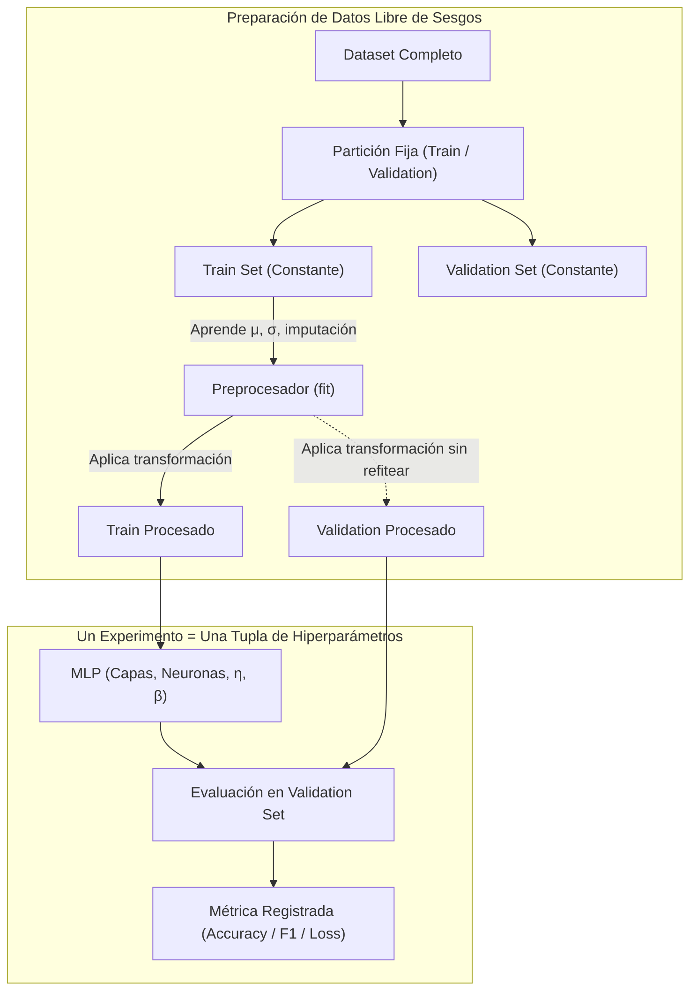
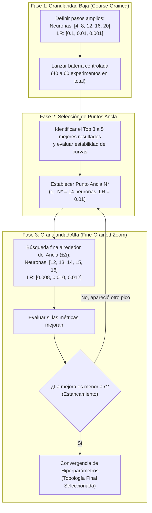
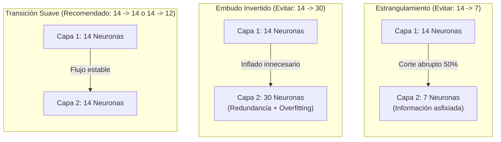
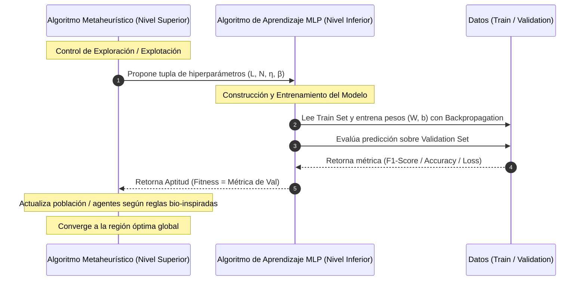
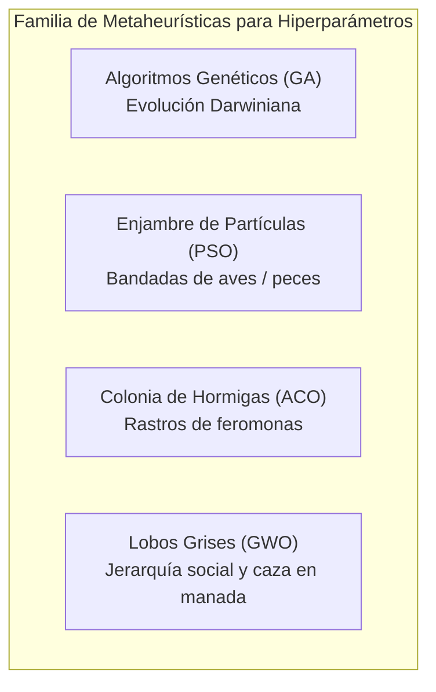

	
# Metodología de Búsqueda de Topología, Cuellos de Botella, Grid Search Jerárquico y Optimización Metaheurística
*Lunes, 5 de octubre de 2026*

## Conexiones
- Preprocesamiento, partición de datos y sobreajuste: [[16. Dinámica del Hiperplano con Momento, Preprocesamiento para Redes, Sobreajuste y Partición de Datos]]
- Arquitectura multicapa y retropropagación: [[15. Redes Neuronales Multicapa (MLP) y Algoritmo de Propagación Hacia Atrás (Backpropagation)]]
- Tasa de aprendizaje y calibración de pesos: [[14. Algoritmo de Entrenamiento del Perceptrón, Regla de Aprendizaje y Calibración de Pesos]]
- Muestreo, estabilidad y cobertura convexa: [[4. Población, Muestreo, Train-Test y Cobertura Convexa de Patrones]]

---

## Conceptos Clave
- **¿Qué es un Experimento en Redes?** Una corrida completa de entrenamiento y validación evaluando una tupla fija de hiperparámetros $(\text{arquitectura}, \eta, \beta, \dots)$ sobre particiones de datos estrictamente congeladas.
- **Garantía y Rigor Metodológico:** Los resultados reportados deben tener garantía formal de ser los mejores dentro de un proceso sistemático y reproducible, no descubrimientos por azar.
- **Transferencia Iterativa de Hiperparámetros:** Los hiperparámetros que mejores resultados arrojan en una fase de experimentación se convierten en la base inmutable para la siguiente etapa.
- **Impacto del Número de Capas en las Épocas:** Al aumentar el número de capas ocultas, el hiperparámetro más fuertemente alterado es el **número de épocas necesarias para la convergencia**, exigiendo monitoreo continuo de curvas de aprendizaje y criterios de parada.
- **Aislamiento de Variables y Congelación Train-Val:** Las particiones `Train` y `Validation` se mantienen **estrictamente constantes** para que la métrica refleje la arquitectura y no la variabilidad muestral.
- **Prevención de Sesgos (Evitar *Data Leakage*):** Todos los escaladores (Z-Score, Min-Max) e imputadores se ajustan (`fit`) **únicamente con los datos de Train** y solo se aplican (`transform`) a Validation.
- **Grid Search Jerárquico (Analogía del Popocatépetl):** Para escalar un volcán no se camina a ciegas por cada metro cuadrado de la falda; primero se hace una búsqueda amplia para ubicar la arista más prometedora (granularidad baja) y luego se realiza el ascenso fino paso a paso (granularidad alta).
- **Peligro del Estrangulamiento (*Bottleneck* Brusco):** Caídas drásticas de neuronas entre capas (ej. $14 \to 7$, reducción del $50\%$) asfixian la información latente de forma irreversible.
- **Peligro del Embudo Invertido:** Pasar de pocas a muchas neuronas (ej. $14 \to 30$) crea un cuello de botella abajo; la capa superior solo añade parámetros redundantes y severo sobreajuste.
- **Arquitectura de Optimización en Dos Niveles (Bi-Level):** Nivel inferior (Backpropagation ajusta $W, b$ en `Train`) vs. Nivel superior (Metaheurística explora el hiperespacio guiada por `Validation`).
- **Alcance Académico (Primer vs. Segundo Parcial):** El **Primer Parcial** evalúa hasta el Grid Search Jerárquico. Los **Algoritmos Genéticos y Metaheurísticas** se profundizarán en el **Segundo Parcial** para proyectos más avanzados de Machine Learning.

---

## 1. Fundamentos: ¿Qué es un Experimento y por qué Congelar Train-Validation?

En minería de datos, un **experimento de calibración** consiste en instanciar una red neuronal con una configuración exacta de hiperparámetros, entrenarla sobre el conjunto `Train` y medir su capacidad predictiva sobre un conjunto `Validation` independiente.



### 1.1. ¿Qué son los sesgos al preparar datos?
1. **Fuga de Información (*Data Leakage*):** Ocurre si calculamos la media o desviación estándar sobre la totalidad de la base de datos antes de partir en Train/Val. El modelo "ve" información de validación antes de tiempo, generando un rendimiento falsamente alto que fracasará en producción.
2. **Sesgo de Partición Flotante:** Si en cada prueba se re-muestrea aleatoriamente Train y Validation, no sabrás si el Accuracy subió porque la topología fue mejor o porque a Validation le tocaron datos más fáciles de clasificar. **La partición debe ser idéntica para todos los experimentos.**

---

## 2. Grid Search Jerárquico (Coarse-to-Fine)

### 2.1. El problema de la biblioteca (`GridSearchCV` tradicional)
Si intentamos probar de una sola vez:
- 10 opciones de neuronas en Capa 1 $\times$ 10 opciones en Capa 2 $\times$ 5 valores de $\eta$ $\times$ 4 valores de $\beta$ = **2,000 experimentos**.
- Con validación cruzada de 5 pliegues ($5\text{-fold}$): $2,000 \times 5 =$ **10,000 entrenamientos de redes**.
- Esto satura cualquier máquina y es ridículamente ineficiente porque prueba combinaciones absurdas en zonas que ya se sabe que fallan.

### 2.2. La Solución: Búsqueda por Etapas en Dos Fases



1. **Etapa 1 (Granularidad Gruesa / Coarse):** Reducir drásticamente el número de combinaciones a un paquete manejable de **40 a 60 experimentos**. Se toman saltos grandes en los hiperparámetros para abarcar todo el espacio sin agotar recursos.
2. **Punto Ancla (*Anchor Point*):** Se analizan los mejores candidatos. Si la zona de 12 a 16 neuronas arroja las mejores métricas de validación, esa región se convierte en nuestro punto ancla.
3. **Etapa 2 (Granularidad Fina / Fine):** Se hace "zoom" local con pasos de 1 en 1 o variaciones muy sutiles de la tasa de aprendizaje. Solo se profundiza sobre las combinaciones más prometedoras, jamás sobre todas.
4. **Regla de Transferencia Acumulativa:** Los hiperparámetros que resultan óptimos en una etapa se convierten en la base fija para la siguiente experimentación (ej. al calibrar 2 capas o añadir regularización).
5. **Criterio de Parada / Estancamiento:** Cuando las mejoras numéricas en validación sean marginales ($\Delta < 0.001$), la búsqueda se detiene. Hemos encontrado el óptimo local más robusto.

> [!TIP] La Analogía del Ascenso al Popocatépetl
> Para llegar al cráter del volcán Popocatépetl, ningún montañista explora cada metro cuadrado de la falda (eso equivaldría a un Grid Search exhaustivo completo, prohibitivo en tiempo y energía). En su lugar:
> 1. Primero hace un reconocimiento panorámico para identificar cuál es la cresta o ladera viable (Búsqueda gruesa / identificación de la región prometedora).
> 2. Una vez ubicada la arista correcta (Punto Ancla), concentra todo el esfuerzo en ascender paso a paso por esa ruta, afinando el trazado hasta alcanzar la cumbre (Búsqueda fina y convergencia).

> [!NOTE] Dinámica de Laboratorio
> En la sesión del **Miércoles 7 de octubre**, el profesor revisará los resultados concretos de las combinaciones exploradas en esta batería para comparar el rendimiento empírico.

---

## 3. Transición de 1 Capa a 2 Capas Ocultas

### 3.1. ¿Por qué el Top 3 a 5 de una capa?
Un modelo con 14 neuronas puede superar a uno de 12 neuronas por mero azar en los pesos iniciales. Seleccionar el **Top 3 a 5** permite:
- Confirmar que existe una **zona de estabilidad** (no un pico solitario y ruidoso).
- Determinar el valor central de neuronas $N^*$ para usar como base al explorar la segunda capa.

### 3.2. Reglas de Transición: Prevención de Cuellos de Botella

Supongamos que el punto ancla de una capa fue $N^* = 14$ neuronas:

| Tipo de Transición | Configuración ($C_1 \to C_2$) | Dinámica del Espacio Latente | Recomendación |
| :--- | :--- | :--- | :--- |
| **Isotrópica / Rectangular** | $14 \to 14$ | Mantiene la capacidad representacional entre capas sin asfixiar el flujo. | **Punto de partida ideal** |
| **Piramidal Moderada** | $14 \to 12$ | Condensación gradual de características hacia la capa de salida. | **Válida** |
| **Estrangulamiento (*Bottleneck*)** | $14 \to 7$ | Reducción súbita del $50\%$. Asfixia la información y degrada el gradiente. | **Prohibido** |
| **Embudo Invertido** | $14 \to 30$ | La primera capa ya actuó como cuello de botella. La segunda solo añade pesos redundantes y sobreajuste. | **Prohibido** |



---

## 4. Por qué Más Capas NO Implica Mejor Convergencia

1. **Desvanecimiento del Gradiente (*Vanishing Gradient*):** A mayor profundidad, la regla de la cadena multiplica derivadas que pueden anular el gradiente hacia las capas iniciales, deteniendo su entrenamiento.
2. **Complejidad del Paisaje de Pérdida:** Cada capa oculta incrementa la no convexidad, creando mesetas (*saddle points*) y mínimos locales engañosos.
3. **Impacto Crítico en el Número de Épocas:** Al aumentar el número de capas ocultas, el parámetro más afectado suele ser el **número de épocas necesarias para converger**. La señal de error tarda más en calibrar todas las capas intermedias, por lo que una red profunda rara vez converge en la misma cantidad de épocas que una red de una sola capa; hay que vigilar de cerca el parámetro `max_iter` y los criterios de parada temprana (*early stopping*).
4. **Principio de Parsimonia (Navaja de Ockham):** Si una red de 1 capa con 14 neuronas obtiene un rendimiento similar a una de 2 capas ($14 \to 14$), **siempre se elige la de 1 capa** por ser más simple, rápida y menos propensa a sobreajuste.

---

## 5. Implementación Práctica: Pipeline Coarse-to-Fine en Python

```python
import numpy as np
from sklearn.model_selection import train_test_split, GridSearchCV
from sklearn.preprocessing import StandardScaler
from sklearn.neural_network import MLPClassifier
from sklearn.pipeline import Pipeline

# 1. Partición estricta y congelada (Evitar sesgo de partición)
X_train, X_val, y_train, y_val = train_test_split(
    X, y, test_size=0.2, random_state=42, stratify=y
)

# 2. Pipeline para aislar el escalado (Evitar Data Leakage)
pipe = Pipeline([
    ('scaler', StandardScaler()),
    ('mlp', MLPClassifier(max_iter=300, random_state=42, early_stopping=True))
])

# FASE 1: Búsqueda Gruesa (Coarse Grid: ~45 combinaciones)
param_grid_coarse = {
    'mlp__hidden_layer_sizes': [(4,), (8,), (12,), (16,), (20,)],
    'mlp__learning_rate_init': [0.1, 0.01, 0.001],
    'mlp__momentum': [0.1, 0.2, 0.3]
}
grid_coarse = GridSearchCV(pipe, param_grid_coarse, cv=3, scoring='f1_macro', n_jobs=-1)
grid_coarse.fit(X_train, y_train)

# Supongamos que el mejor resultado dio (16,) con lr=0.01 (Punto Ancla)
# FASE 2: Búsqueda Fina en Vecindad (Fine Grid)
param_grid_fine = {
    'mlp__hidden_layer_sizes': [(14,), (15,), (16,), (17,), (18,), (16, 16), (16, 14)],
    'mlp__learning_rate_init': [0.008, 0.01, 0.012],
    'mlp__momentum': [0.2]
}
grid_fine = GridSearchCV(pipe, param_grid_fine, cv=3, scoring='f1_macro', n_jobs=-1)
grid_fine.fit(X_train, y_train)

print(f"Mejor Topología Final: {grid_fine.best_params_}")
```

---

## 6. Más Allá del Grid Search: Búsqueda Metaheurística de Hiperparámetros (Bio-inspirada)

El Grid Search Jerárquico es la base técnica mínima recomendada. Sin embargo, los sistemas modernos de construcción y sintonización de modelos (*AutoML*) recurren a **algoritmos de optimización metaheurística**.

### 6.1. Esquema de Optimización en Dos Niveles (Bi-Level Architecture)

La construcción de modelos de alto nivel desacopla dos algoritmos especializados que trabajan en sincronía:



1. **Nivel Inferior (Algoritmo de Aprendizaje):** Es la red neuronal propiamente dicha. Su única tarea es aprender los pesos internos $\mathbf{W}, \mathbf{b}$ usando retropropagación (*Backpropagation*) y descenso de gradiente sobre el conjunto `Train`.
2. **Nivel Superior (Algoritmo Metaheurístico):** No entrena neuronas; lleva el control estratégico de la **exploración del hiperespacio**. Propone combinaciones de hiperparámetros y usa la métrica sobre `Validation` como su **función de aptitud (*fitness function*)**.

---

### 6.2. La Familia de Metaheurísticas Bio-inspiradas

En lugar de evaluar una cuadrícula estática, estos algoritmos definen reglas estocásticas inteligentes para equilibrar **Exploración** (explorar zonas nuevas del hiperespacio para no atorarse en óptimos locales) y **Explotación** (afinar la búsqueda en las regiones más prometedoras).



#### 1. Algoritmos Genéticos (GA - Genetic Algorithms)
- **Inspiración:** Selección natural y genética darwiniana.
- **Funcionamiento en Redes:**
  - Un "individuo" o "cromosoma" es un vector con los hiperparámetros: $\text{Cromosoma} = [\text{Capas}=2, \text{Neuronas}_1=16, \text{Neuronas}_2=14, \eta=0.01, \beta=0.2]$.
  - **Selección:** Las redes con mejor *fitness* (validación) tienen más probabilidad de reproducirse.
  - **Cruce (*Crossover*):** Se combinan los mejores atributos de dos redes exitosas (ej. la topología de la Red A con la tasa de aprendizaje de la Red B).
  - **Mutación:** Pequeñas alteraciones aleatorias que introducen combinaciones inesperadas, evitando el estancamiento prematuro.

#### 2. Optimización por Enjambre de Partículas (PSO - Particle Swarm Optimization)
- **Inspiración:** Inteligencia de enjambre inspirada en el movimiento sincronizado de parvadas de aves o bancos de peces (Kennedy & Eberhart).
- **Funcionamiento en Redes:**
  - Cada "partícula" representa una configuración de hiperparámetros navegando por el espacio multidimensional continuo/discreto.
  - Cada partícula actualiza su trayectoria guiada por dos fuerzas:
    1. **Memoria individual ($p_{best}$):** La mejor configuración que esa partícula ha probado en su historia.
    2. **Memoria social colectiva ($g_{best}$):** La mejor configuración descubierta por *cualquier* partícula del enjambre hasta ese momento.
  - El enjambre converge colaborativamente hacia el óptimo global a gran velocidad.

#### 3. Optimización por Colonia de Hormigas (ACO - Ant Colony Optimization)
- **Inspiración:** Comportamiento de forrajeo de hormigas reales que encuentran el camino más corto hacia la comida usando rastros de feromonas químicas (Marco Dorigo).
- **Funcionamiento en Redes:**
  - La selección de hiperparámetros se modela como un grafo de decisiones (nodo 1: ¿cuántas capas?, nodo 2: ¿cuántas neuronas?, nodo 3: ¿qué $\eta$?).
  - Hormigas artificiales construyen arquitecturas recorriendo el grafo.
  - Las configuraciones que alcanzan mayor métrica de validación depositan más **"feromona virtual"** sobre las aristas del grafo.
  - Las siguientes generaciones de hormigas tienden a elegir los caminos más transitados y exitosos.

#### 4. Optimizador del Lobo Gris (GWO - Grey Wolf Optimizer)
- **Inspiración:** Jerarquía social y estrategia cooperativa de caza en manadas de lobos grises (*Canis lupus*, Mirjalili et al., 2014).
- **Funcionamiento en Redes:**
  - Se clasifica a la población de redes según su métrica de validación en cuatro roles:
    - **Lobo Alfa ($\alpha$):** La mejor red encontrada hasta el momento (el líder).
    - **Lobo Beta ($\beta$):** El segundo mejor modelo (consejero del alfa).
    - **Lobo Delta ($\delta$):** El tercer mejor modelo (explorador / centinela).
    - **Lobos Omega ($\omega$):** El resto de las redes candidatas de la manada.
  - Durante la búsqueda, los lobos $\omega$ actualizan sus hiperparámetros moviéndose en dirección al triángulo de cerco formado por los líderes $\alpha, \beta$ y $\delta$, refinando el cerco alrededor del hiperparámetro óptimo.

---

### 6.3. Cuadro Comparativo de Estrategias de Búsqueda

| Criterio | Grid Search Clásico | Grid Search Jerárquico | Búsqueda Aleatoria (*Random*) | Optimización Metaheurística (GA / PSO / GWO) |
| :--- | :--- | :--- | :--- | :--- |
| **Enfoque** | Fuerza bruta exhaustiva | Por etapas (grueso $\to$ fino) | Muestreo probabilístico ciego | Búsqueda adaptativa inteligente guiada |
| **Costo Computacional** | Crítico / Prohibitivo ($O(K^d)$) | Moderado (40-60 iniciales) | Fijo según presupuesto | Eficiente (enfocado en zonas de alto retorno) |
| **Riesgo de Atorarse** | No se atora, pero no termina | Posible si el ancla fue engañosa | No aprende de la historia previa | Muy bajo (balancea exploración y explotación) |
| **Nivel de Automatización** | Nativo en bibliotecas | Manual por fases | Nativo en bibliotecas | Requiere arquitectura Bi-Level (*Wrapper*) |
| **Uso en Industria** | Casos triviales ($d \le 2$) | Protocolo estándar de laboratorio | Línea base rápida | AutoML y modelos de producción complejos |

---

## 7. Hoja de Ruta Inmediata y Avisos Académicos
- **Paso Obligatorio Inicial:** Antes de avanzar a métodos más complejos, se debe comenzar con la búsqueda simple y dominar la implementación y análisis del **Grid Search Jerárquico (*Coarse-to-Fine*)**.
- **Sesión del Miércoles 7 de octubre de 2026:**
  - **Revisión de Combinaciones:** Se analizarán empíricamente los resultados de las combinaciones de hiperparámetros exploradas en la batería de pruebas.
  - **Demostración en Scikit-learn:** Ejemplo práctico de construcción de un Grid Search por etapas, medición de tiempos y registro de curvas de convergencia.
  - **Definición del Primer Parcial:** Acuerdos sobre fecha oficial, formato (práctico/teórico) y corte temático acumulado del primer bloque del curso (cierra hasta Grid Search Jerárquico).
- **Proyección al Segundo Parcial:**
  - Los **Algoritmos Genéticos y Metaheurísticas** son técnicas más sofisticadas orientadas a proyectos de machine learning más avanzados/serios, por lo que serán abordados formalmente durante el **Segundo Parcial**.
