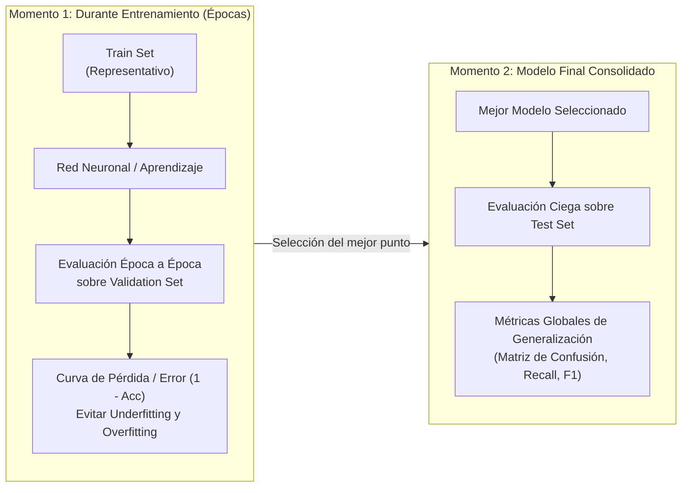
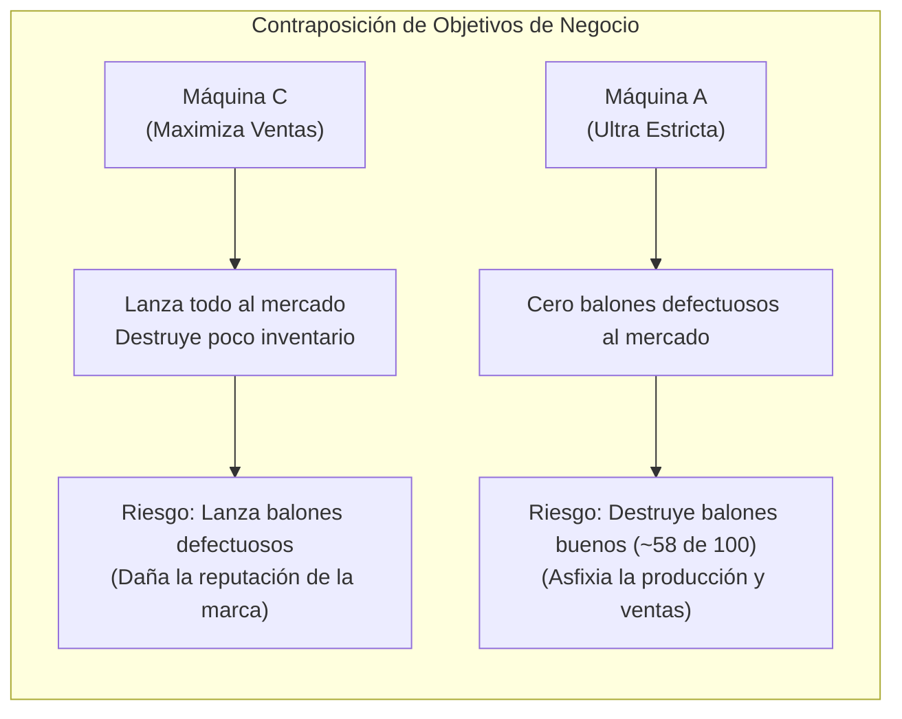
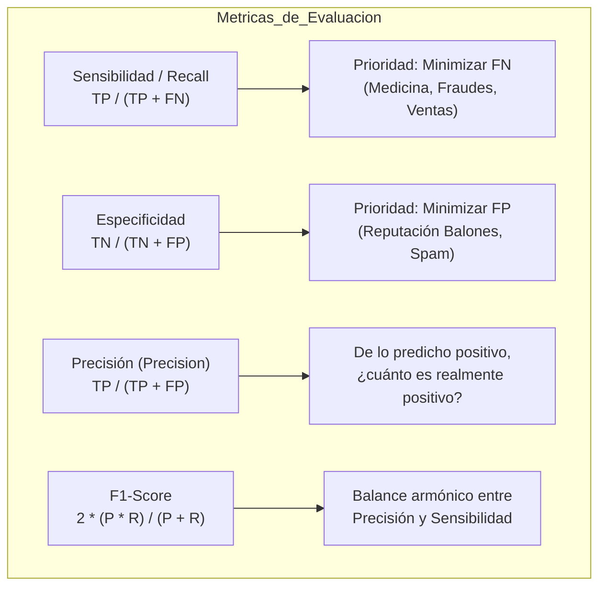

# Métricas de Evaluación en Clasificación, Matriz de Confusión y Costos Asimétricos de Error
*Miércoles, 7 de octubre de 2026*

## 📌 Tareas y Elementos a Retomar
- [ ] Revisar el tema de búsqueda de hiperparámetros controlada por otro algoritmo (metaheurísticas / bio-inspiradas) de cara al proyecto final. 📅 2026-10-14
- [ ] Estudiar las métricas de clasificación en detalle (Precision, Recall, F1) para la sesión del viernes. 📅 2026-10-09

## Conexiones
- Búsqueda de topología y Grid Search Jerárquico: [[17. Metodología de Búsqueda de Topología, Cuellos de Botella y Transición de Capas en Redes Neuronales]]
- Partición Train-Val-Test, dinámica de sobreajuste y parada temprana: [[16. Dinámica del Hiperplano con Momento, Preprocesamiento para Redes, Sobreajuste y Partición de Datos]]
- Cobertura convexa y representatividad de la muestra: [[4. Población, Muestreo, Train-Test y Cobertura Convexa de Patrones]]

---

## Conceptos Clave
- **La Pregunta Fundamental:** El Grid Search y las metaheurísticas necesitan una función objetivo para comparar modelos, pero **el Accuracy tradicional no siempre es una métrica adecuada** para medir la calidad real de un clasificador.
- **Los Dos Momentos Críticos de Medición:**
  1. *Durante el Entrenamiento / Validación (Época tras época):* Se monitorea sobre el conjunto `Validation` para diagnosticar subajuste (*underfitting*), sobreajuste (*overfitting*), trazar curvas de pérdida ($1 - \text{Accuracy}$ o Log-Loss) y activar la parada temprana (*early stopping*).
  2. *Evaluación Final del Modelo:* Se realiza una sola vez sobre el conjunto `Test` (completamente ciego) para obtener métricas globales de generalización en producción.
- **Naturaleza de las Métricas:**
  - *Valores Discretos (Clasificación):* Matrices de confusión, tasas de acierto, sensibilidad, especificidad, precisión, F1-Score.
  - *Valores Continuos (Regresión):* Estadísticas de error residual (MSE, RMSE, MAE, $R^2$).
  - *No Supervisado (Clustering):* Cohesión, separación, coeficiente de silueta.
- **La Trampa del Accuracy:** El Accuracy $\frac{TP + TN}{\text{Total}}$ trata todos los errores como equivalentes (costo simétrico) y es engañoso cuando las clases están desbalanceadas.
- **Costo Asimétrico de Errores en la Vida Real:**
  - **Error Tipo I (Falso Positivo - FP):** Predecir positivo cuando la realidad es negativa (ej. alarma falsa de cáncer). Costo: estudios complementarios, estrés temporal.
  - **Error Tipo II (Falso Negativo - FN):** Predecir negativo cuando la realidad es positiva (ej. decirle a un paciente con cáncer que está sano y mandarlo a su casa). Costo: progresión de la enfermedad y riesgo de muerte. **Es un error gravísimo.**

---

## 1. Contexto: ¿Cómo Medimos la Calidad de un Resultado?

En las sesiones previas construimos el proceso de exploración de hiperparámetros (Topología $\to$ Grid Search Jerárquico $\to$ Metaheurísticas). Sin embargo, cualquier optimizador depende enteramente de la **métrica con la que juzga qué modelo es mejor**.



### 1.1. Comparativa de los Dos Momentos de Evaluación

| Criterio | Momento 1: Validación Dinámica | Momento 2: Evaluación Final en Test |
| :--- | :--- | :--- |
| **Conjunto Utilizado** | `Validation Set` (congelado) | `Test Set` (completamente ciego) |
| **Frecuencia** | Al final de cada época o experimento | Una sola vez al finalizar el proyecto |
| **Objetivo** | Controlar el ajuste, afinar hiperparámetros y detener el entrenamiento (*early stopping*). | Medir la capacidad real de generalización ante datos nunca vistos. |
| **Peligro a Evitar** | Caer en la zona de subajuste (pocas épocas) o sobreajuste (demasiadas épocas). | Tomar decisiones de ajuste con Test (arruinaría la ceguera de la prueba). |

---

## 2. La Matriz de Confusión

La **Matriz de Confusión** es la herramienta fundamental para analizar cómo se equivoca un clasificador discreto. No solo nos dice *cuántas veces acertó*, sino *qué tipo de error cometió*.

### 2.1. Estructura Estándar de la Matriz

```
                          PREDICCIÓN DEL MODELO
                       Positivo (+)         Negativo (-)
                 ┌──────────────────────┬──────────────────────┐
   Positivo (+)  │  Verdadero Positivo  │   Falso Negativo     │
                 │        (TP)          │    (FN - Tipo II)    │
VALOR            ├──────────────────────┼──────────────────────┤
REAL             │    Falso Positivo    │  Verdadero Negativo  │
   Negativo (-)  │    (FP - Tipo I)     │        (TN)          │
                 └──────────────────────┴──────────────────────┘
```

- **Verdadero Positivo ($TP$ / Real $+$, Predicho $+$):** La condición existe y el modelo la detectó correctamente.
- **Verdadero Negativo ($TN$ / Real $-$, Predicho $-$):** La condición no existe y el modelo la descartó correctamente.
- **Falso Positivo ($FP$ / Error Tipo I / Real $-$, Predicho $+$):** Instancia negativa que el modelo traduce erróneamente como positiva (Falsa Alarma).
- **Falso Negativo ($FN$ / Error Tipo II / Real $+$, Predicho $-$):** Instancia positiva que el modelo traduce erróneamente como negativa (Omisión Peligrosa).

> [!IMPORTANT] La Diagonal Principal de la Matriz
> - **Sobre la diagonal principal ($TP$ y $TN$):** Se concentran todos los **aciertos** del modelo. Entre más densa sea la diagonal, mejor clasifica.
> - **Fuera de la diagonal ($FP$ y $FN$):** Se ubican todas las **equivocaciones** del clasificador.

---

## 3. Ejemplo 1: Diagnóstico Médico (Cáncer) y Costo del Error Tipo II

Para entender por qué el Accuracy es insuficiente, analicemos el ejemplo expuesto por el profesor con tres médicos evaluando una población de **100 pacientes** sometidos a tamizaje de cáncer (donde la clase positiva es *Tiene cáncer*):

$$\text{Accuracy} = \frac{TP + TN}{\text{Total de Pacientes}} = \frac{TP + TN}{100}$$

### 3.1. Caso 1: Médico A vs. Médico B (Mismo Accuracy = 90%)

#### Matriz del Médico A (Descartado):
- $TP = 40$ (Enfermos detectados)
- $TN = 50$ (Sanos confirmados)
- $FN = 8$ (Enfermos diagnosticados como sanos $\to$ **Error Tipo II: Gravísimo**)
- $FP = 2$ (Sanos diagnosticados como enfermos $\to$ **Error Tipo I**)

$$\text{Acc}_A = \frac{40 + 50}{100} = \frac{90}{100} = 90\%$$

```
Médico A (Descartado por negligencia):
                   Predicho (+)    Predicho (-)
Real Positivo (+)       40              8   <-- ¡8 enfermos graves enviados a casa sin tratamiento!
Real Negativo (-)        2             50
```

#### Matriz del Médico B (Recomendado):
- $TP = 40$ (Enfermos detectados)
- $TN = 50$ (Sanos confirmados)
- $FN = 2$ (Enfermos diagnosticados como sanos $\to$ **Error Tipo II: Muy bajo**)
- $FP = 8$ (Sanos diagnosticados como enfermos $\to$ **Error Tipo I**)

$$\text{Acc}_B = \frac{40 + 50}{100} = \frac{90}{100} = 90\%$$

```
Médico B (Recomendado):
                   Predicho (+)    Predicho (-)
Real Positivo (+)       40              2   <-- Solo 2 falsos negativos (salva más vidas)
Real Negativo (-)        8             50
```

#### ¿Por qué se Descarta al Médico A y se Recomienda al Médico B?
- Ambos tienen un **$90\%$ de Accuracy**. A ojos del Accuracy general son idénticos.
- Sin embargo, en medicina diagnóstica el **Error Tipo II ($FN$) es letal**: el Médico A manda a **8 pacientes con cáncer a su casa** creyendo que están sanos, impidiéndoles recibir tratamiento a tiempo.
- El **Médico B comete menos errores Tipo II** (solo 2). Sus 8 errores Tipo I son personas sanas a las que asustó momentáneamente, pero un estudio complementario posterior corregirá el diagnóstico sin que nadie muera por ello.
- **Conclusión Clínica:** El **Médico A queda descartado**. Se recomienda ampliamente al **Médico B**.

---

### 3.2. Caso 2: El Médico C (Conservador Extremo con 0 Falsas Alarmas)

El profesor planteó un tercer escenario:

#### Matriz del Médico C:
- $TP = 40$
- $TN = 40$
- $FN = 20$
- $FP = 0$

$$\text{Acc}_C = \frac{40 + 40}{100} = \frac{80}{100} = 80\%$$

```
Médico C:
                   Predicho (+)    Predicho (-)
Real Positivo (+)       40             20   <-- ¡20 enfermos no diagnosticados! (33.3% del total con cáncer)
Real Negativo (-)        0             40   <-- Cero falsas alarmas (FP = 0)
```

#### Análisis del Médico C:
- Su ventaja: tiene $FP = 0$ (especificidad perfecta; si te dice que tienes cáncer, es $100\%$ seguro).
- Su catástrofe: para evitar alarmar a gente sana, se volvió tan estricto y conservador que **omitió a 20 personas con cáncer ($FN = 20$)**. Uno de cada tres enfermos se fue sin diagnóstico.
- Demuestra que optimizar únicamente para evitar el Error Tipo I dispara dramáticamente el Error Tipo II.

---

## 4. Ejemplo 2: Control de Calidad en Producción (Pelotas de Fútbol y Visión por Computadora)

El profesor presentó un segundo caso en el sector manufacturero: un sistema de visión por computadora clasifica pelotas de fútbol en la línea de ensamble para decidir cuáles salen a la venta y cuáles se destruyen.

- **Clase Positiva (+):** Cumple con la calidad requerida $\to$ **Se lanza al mercado / Se vende**.
- **Clase Negativa (-):** Defectuosa $\to$ **Se destruye / Se descarta**.

### 4.1. Definición de los Errores en la Fábrica
1. **Falso Positivo ($FP$ - Error Tipo 1):** Una pelota realmente defectuosa es clasificada como buena y **se lanza al mercado**.
   - *Impacto:* Destruye el prestigio, imagen y reputación de la marca ante los clientes.
2. **Falso Negativo ($FN$ - Error Tipo 2):** Una pelota en perfecto estado es clasificada como defectuosa y **se destruye**.
   - *Impacto:* Pérdida directa de inventario, merma de materia prima y reducción del volumen de ventas.

### 4.2. La Contraposición de Negocio: Tres Máquinas (A, B y C)



- **Perspectiva de Calidad y Prestigio:** La **Máquina C es la menos recomendable** porque comete demasiados Falsos Positivos ($FP$), permitiendo que salgan pelotas defectuosas al consumidor.
- **Perspectiva de Ventas y Producción:** La **Máquina A es desastrosa** porque destruye cerca de $58$ pelotas buenas de cada $100$ ($FN$ masivo), reduciendo drásticamente la oferta disponible para vender. En cambio, la **Máquina C maximiza el volumen de pelotas vendidas**.
- **Conclusión de Minería:** **No existe una máquina universalmente "correcta"**. La elección entre Máquina A, B o C depende de la estrategia de la compañía:
  - Si es el balón oficial de la Copa del Mundo (FIFA) $\to$ Prioridad absoluta a la Calidad (Minimizar $FP$).
  - Si son pelotas recreativas económicas de alto volumen $\to$ Prioridad al Volumen de Ventas (Minimizar $FN$).
- **El Accuracy no captura esta diferencia estratégica.**

---

## 5. Métricas Derivadas que Corrigen al Accuracy

Para capturar la asimetría de estos errores, se emplean métricas específicas:



### 5.1. Sensibilidad o Cobertura (*Recall* / *True Positive Rate*)
Mide la proporción de casos positivos reales que el modelo fue capaz de detectar:
$$\text{Recall} = \frac{TP}{TP + FN}$$

- **Médico B (Recomendado):** $\frac{40}{40 + 2} = \frac{40}{42} \approx \mathbf{95.2\%}$ (Excelente cobertura de pacientes con cáncer).
- **Médico A (Descartado):** $\frac{40}{40 + 8} = \frac{40}{48} \approx \mathbf{83.3\%}$ (Deficiente; escapa un 16.7% de los enfermos).
- **Médico C:** $\frac{40}{40 + 20} = \frac{40}{60} \approx \mathbf{66.7\%}$ (Pésimo; omite un tercio de los enfermos).

### 5.2. Especificidad (*True Negative Rate*)
Mide la capacidad de descartar a los sanos sin levantar falsas alarmas:
$$\text{Especificidad} = \frac{TN}{TN + FP}$$
- **Médico B:** $\frac{50}{50 + 8} = \frac{50}{58} \approx 86.2\%$
- **Médico A:** $\frac{50}{50 + 2} = \frac{50}{52} \approx 96.2\%$
- **Médico C:** $\frac{40}{40 + 0} = 100.0\%$

### 5.3. Precisión (*Precision*)
Mide la certeza del modelo cuando emite un diagnóstico positivo:
$$\text{Precisión} = \frac{TP}{TP + FP}$$

---

## 6. Resumen Comparativo de los Médicos

| Médico | Accuracy | Recall (Sensibilidad) | Especificidad | Error Tipo I ($FP$) | Error Tipo II ($FN$) | Evaluación Cualitativa |
| :--- | :---: | :---: | :---: | :---: | :---: | :--- |
| **Médico B (Recomendado)** | $90\%$ | **$95.2\%$** | $86.2\%$ | $8$ | **$2$** | **El mejor para medicina:** Minimiza el Error Tipo II ($FN$). Salva más vidas. |
| **Médico A (Descartado)** | $90\%$ | $83.3\%$ | **$96.2\%$** | $2$ | **$8$** | **Descartado:** Cuadriplica las omisiones mortales ($FN=8$). Inviable clínicamente. |
| **Médico C** | $80\%$ | $66.7\%$ | **$100.0\%$** | **$0$** | $20$ | **Inviable clínicamente:** Deja sin tratamiento al 33% de los enfermos. |

---

## 7. F1-Score y F1 Macro: La Solución al Desbalance de Clases

Cuando ninguna métrica individual basta, se recurre a la media armónica entre Precisión y Sensibilidad:

$$\text{F1-Score} = 2 \cdot \frac{\text{Precisión} \cdot \text{Recall}}{\text{Precisión} + \text{Recall}} = \frac{2 \cdot TP}{2 \cdot TP + FP + FN}$$

### 6.1. ¿Qué es el F1 Macro (*Macro-Averaged F1*)?
En problemas multiclase o con clases muy desbalanceadas (ej. 95% sanos y 5% enfermos), calcular el F1 global agrupado disfraza la realidad.

El **F1 Macro** calcula el F1 de forma independiente para cada clase $k \in \{1, \dots, K\}$ y luego obtiene su **promedio aritmético simple sin ponderar por frecuencia**:

$$\text{F1 Macro} = \frac{1}{K} \sum_{k=1}^K \text{F1}_k$$

- **La gran ventaja:** Otorga el **mismo peso a las clases minoritarias** que a las mayoritarias. Si el modelo ignora la clase pequeña, su F1 individual será cercano a $0$ y el F1 Macro se desplomará, obligando al modelo a aprender todas las categorías.

---

## 8. Guía Contextual: ¿Cuándo sirve el Accuracy y qué Métrica Elegir?

No existe una métrica universalmente buena; **la métrica adecuada la define el contexto del negocio o problema**:

```mermaid
graph TD
    Q{"¿Cómo son las clases y los costos de error?"}
    Q -->|Clases balanceadas + Errores con igual costo| M1["Accuracy<br>(ej. Dígitos escritos a mano)"]
    Q -->|Error Tipo II (FN) es mortal o crítico| M2["Recall / Sensibilidad<br>(ej. Cáncer, Fraude bancario)"]
    Q -->|Error Tipo I (FP) es muy costoso| M3["Precisión / Especificidad<br>(ej. Filtro de Spam, Sentencias legales)"]
    Q -->|Clases desbalanceadas + Todas importan| M4["F1 Macro<br>(Equilibrio estricto entre clases)"]
```

| Contexto / Escenario | Costo Dominante | Métrica Primaria Recomendada | ¿Sirve el Accuracy? |
| :--- | :--- | :--- | :---: |
| **Tamizaje Médico / Cáncer** | $FN$ (Dejar ir a un enfermo sin tratamiento es letal) | **Sensibilidad (*Recall*)** | **NO** (Peligroso) |
| **Detección de Fraude Financiero** | $FN$ (No detectar una transacción fraudulenta cuesta dinero) | **Sensibilidad (*Recall*)** | **NO** (Clase muy minoritaria) |
| **Filtro de Correo Spam** | $FP$ (Mandar una oferta laboral o correo urgente a Spam) | **Precisión (*Precision*)** | Parcial |
| **Justicia Penal / Pruebas Forenses** | $FP$ (Condenar a un inocente a prisión) | **Especificidad / Precisión** | **NO** |
| **Reconocimiento de Dígitos (MNIST)** | Costos simétricos e igual frecuencia por dígito | **Accuracy** | **SÍ** (Ideal y suficiente) |
| **Minería con Clases Desbalanceadas** | Evitar que la clase dominante asfixie a la minoritaria | **F1 Macro** | **NO** (Ilusión de alto desempeño) |

---

## 9. Hoja de Ruta para la Próxima Sesión (Viernes 9 de Octubre)
- **Deducción Matemática de Métricas:** Se explicarán a fondo las fórmulas y comportamientos de Precisión, Sensibilidad/Recall, Especificidad y F1-Score.
- **Profundización en F1 (Macro vs. Micro vs. Weighted):** Cómo elegir matemáticamente entre promediar por clase (Macro) o ponderar por soporte poblacional (Weighted).
- **Integración con Grid Search Jerárquico:** En Scikit-learn, el parámetro `scoring='f1_macro'` será el timón para guiar la búsqueda de la mejor red de cara al **Primer Examen Parcial**.
