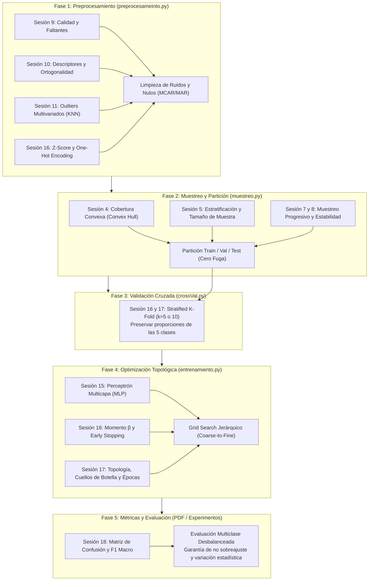

# Guía Maestra de Resolución: 1er Parcial (Proyecto Práctico de RNA)
*Miércoles, 14 de octubre de 2026 • BUAP - FCC*

## 📌 Datos Clave de Entrega
- **Fecha Límite:** Martes, 3 de noviembre de 2026 a las 11:59 PM (vía Microsoft Teams).
- **Entregables Obligatorios:**
  1. **Documento Técnico en PDF:** Respuestas y justificaciones formales a cada una de las 7 preguntas.
  2. **Archivo ZIP:** Código modular limpio (`preprocesameinto.py`, `muestreo.py`, `crossVal.py`, `entrenamiento.py`) y la base de datos trabajada.
  3. **Video Explicativo:** Enlace a video de máximo 3 minutos exponiendo el pipeline, resultados, ventajas y áreas de mejora.
- **Ruta de Archivos en Disco:** `/Users/eddy/personal/escuela/materias/mineria-de-datos/Parcial_1/`

---

## 🎯 Mapeo Clase por Clase: ¿Qué Vimos y Cómo Resuelve el Examen?

Todo el examen se diseñó como un examen integrador acumulativo de las sesiones estudiadas en el semestre:

---

## 📋 Desglose Técnico Pregunta por Pregunta

### Pregunta 1 (1.0 pt): Preprocesamiento de la Base de Datos (`preprocesameinto.py`)
- **Dataset:** `clientes_comercio_1000000_alumnos.csv` ($1,000,000$ filas, $31$ columnas).
- **Atributos a excluir del modelo predictivo:** `id_cliente` (identificador arbitrario que causaría sobreajuste si se deja).
- **Reglas de Dependencia y Consistencia (del Documento Técnico):**
  1. Si `compras_365d == 0`, entonces `ticket_promedio_mxn == 0` y `gasto_total_365d_mxn == 0`.
  2. `compras_con_descuento_365d` y `devoluciones_365d` jamás deben superar a `compras_365d`.
  3. `emails_abiertos_365d` no puede ser mayor que `emails_enviados_365d`.
  4. `carritos_abandonados_365d` debe ser $\le (\text{sesiones\_365d} - \text{compras\_365d})$.
- **Transformación para Redes Neuronales (Sesión 16):**
  - **Variables Categóricas:** Aplicar *One-Hot Encoding* sobre variables nominales sin orden (`region`, `zona`, `canal_preferido`, `dispositivo_preferido`, `categoria_preferida`, `metodo_pago_preferido`).
  - **Variables Numéricas:** Escalado con **Z-Score (StandardScaler)** para que las sumas ponderadas $\sum w_i x_i + b$ de las neuronas no se vean dominadas por atributos con cifras en miles de pesos frente a variables de conteo pequeño.
- **Regla Sagrada contra la Fuga de Datos (*Data Leakage*, Sesión 16 y 17):**
  - El objeto `StandardScaler` o codificador se entrena (`fit`) **exclusivamente con los datos de entrenamiento (`Train`)** y solo se aplica (`transform`) sobre validación y prueba.

---

### Pregunta 2 (2.0 pts): Técnica de Muestreo y Partición (`muestreo.py`)
- **El Reto:** Entrenar una red neuronal multicapa con $1,000,000$ de instancias para optimizar hiperparámetros requeriría días enteros de GPU/CPU.
- **Técnica Justificada:** **Muestreo Estratificado Proporcional** (Sesión 5).
  - La variable objetivo `clase_cliente` tiene 5 clases asimétricas:
    1. `Ocasional`: $39.16\%$
    2. `Inactivo`: $32.51\%$
    3. `Frecuente`: $12.40\%$
    4. `Promocional`: $9.15\%$
    5. `Alto_valor`: $6.78\%$ (Clase minoritaria crítica).
- **Cálculo del Tamaño de Muestra Mínimo ($n$):**
  $$n = \frac{Z^2 \cdot p \cdot q \cdot N}{e^2 \cdot (N - 1) + Z^2 \cdot p \cdot q}$$
  Con $99\%$ de confianza ($Z = 2.576$), margen de error $e = 0.01$ y máxima varianza ($p = q = 0.5$), el tamaño mínimo representativo ronda los $16,500$ registros, pero en redes neuronales se recomienda extraer una muestra estratificada representativa de $50,000$ a $100,000$ instancias para alimentar la partición sin perder cobertura geométrica en el hiperespacio (Sesión 4: *Convex Hull*).
- **Partición Final del Dataset:**
  - $70\%$ **Train**
  - $15\%$ **Validation** (congelado)
  - $15\%$ **Test** (ciego)
- **Salida requerida del script:** Generar los archivos `train.csv`, `validation.csv` y `test.csv`.

---

### Pregunta 3 (1.0 pt): Validación Cruzada Robusta (`crossVal.py`)
- **Elección de $k$:** Se debe justificar teóricamente el uso de **$k = 5$ o $k = 10$ Stratified K-Fold** (Sesión 4 y 16).
- **Argumentación Técnica:**
  - Un $k$ muy pequeño ($k=2$ o $3$) incrementa el sesgo del estimador porque cada modelo se entrena con poca fracción de datos.
  - Un $k$ excesivo ($k > 15$ o *Leave-One-Out*) dispara la varianza y el costo computacional de forma inmanejable para redes neuronales.
  - **$k = 5$** (o $10$) con partición **estratificada** garantiza que cada uno de los $k$ pliegues mantenga exactamente la misma proporción del $6.78\%$ de clientes de `Alto_valor` y $39.16\%$ de `Ocasional`, ofreciendo el balance óptimo entre bajo sesgo y mínima varianza.

---

### Pregunta 4 (2.0 pts): Optimización de Hiperparámetros (`entrenamiento.py`)
- **Librería Obligatoria:** Scikit-Learn (`sklearn.neural_network.MLPClassifier`).
- **Estrategia Metodológica (Sesión 17): Grid Search Jerárquico (*Coarse-to-Fine*):**
  - **Fase 1: Búsqueda Gruesa (40 a 60 combinaciones):**
    - Capas ocultas: explorar monocapa inicial (`hidden_layer_sizes=[(10,), (20,), (30,), (40,)]`).
    - Tasas de aprendizaje iniciales: `learning_rate_init=[0.1, 0.01, 0.001]`.
    - Momento ($\beta$): `momentum=[0.1, 0.2, 0.3]`.
    - Solver: `'adam'` o `'sgd'`.
    - Activación: `'relu'`.
  - **Fase 2: Identificación del Punto Ancla y Búsqueda Fina:**
    - Tomar los 3 a 5 mejores resultados.
    - Probar 2 capas ocultas respetando la regla aprendida en clase: **prohibido estrangular** (ej. evitar caídas del $50\%$ de neuronas entre capa 1 y capa 2) y **prohibido el embudo invertido**.
  - **Parámetros Propios de Scikit-learn a Controlar:**
    - `max_iter`: Número máximo de épocas (al agregar capas se necesitan más épocas, Sesión 17).
    - `early_stopping=True`: Detener el entrenamiento si la métrica de validación deja de mejorar.
    - `n_iter_no_change=15`: Paciencia antes de detener para no caer en sobreajuste.

---

### Pregunta 5 (1.0 pt): Métrica de Calidad de Resultado
- **¿Por qué el Accuracy está PROHIBIDO / DESACREDITADO aquí? (Sesión 18):**
  - Si un modelo predice siempre `Ocasional` e `Inactivo`, obtendrá más del $71\%$ de Accuracy global sin haber detectado a un solo cliente de `Alto_valor` ($6.78\%$). Para el negocio de e-commerce, perder a los clientes de mayor gasto es un desastre financiero.
- **Métrica Primaria Seleccionada:** **F1 Macro (*Macro-Averaged F1-Score*)**:
  $$\text{F1 Macro} = \frac{1}{5} \sum_{k=1}^5 \text{F1}_k$$
  - Calcula el F1 de cada una de las 5 clases por separado y saca el promedio simple no ponderado.
  - Otorga el **mismo peso a la clase minoritaria (`Alto_valor`)** que a la mayoritaria (`Ocasional`), obligando a la red neuronal a no volverse perezosa.
- **Herramienta Complementaria:** La **Matriz de Confusión Multiclase ($5 \times 5$)** para inspeccionar la diagonal principal (aciertos) y detectar entre qué perfiles se confunden los clientes (ej. ¿cuántos `Frecuente` se confunden con `Promocional`?).

---

### Pregunta 6 (2.0 pts): Experimentos, Control de Sobreajuste y Variación Estadística
- **Garantía contra Sobreajuste (Sesión 16 y 17):**
  - Graficar la curva de pérdida (*Loss Curve*) de entrenamiento vs. validación época tras época.
  - El modelo seleccionado debe ubicarse en la meseta previa al rebote del error de validación (*Early Stopping*).
- **Variación Estadística Estimada:**
  - Reportar la media y desviación estándar de la métrica en los $k$ pliegues:
    $$\text{F1 Macro Global} = \bar{X} \pm \sigma$$
  - Incluir tablas comparativas ordenadas de todas las configuraciones evaluadas (mínimo 5 a 10 arquitecturas contrastadas).

---

### Pregunta 7 (1.0 pt): Guion para el Video (Máximo 3 Minutos)

| Segundo | Bloque del Video | Qué decir / Qué mostrar en pantalla |
| :--- | :--- | :--- |
| **0:00 - 0:30** | **Introducción y Problema** | Presentar el problema de clasificar 1M clientes en 5 perfiles futuros con fuerte desbalance de clases (Alto valor 6.78% vs Ocasional 39.16%). |
| **0:30 - 1:15** | **Preprocesamiento y Muestreo** | Mostrar `preprocesameinto.py` (Z-Score y One-Hot sin Data Leakage) y `muestreo.py` (Muestreo Estratificado proporcional de 50k registros manteniendo representatividad). |
| **1:15 - 2:00** | **Grid Search y Métrica F1 Macro** | Mostrar `crossVal.py` ($k=5$ Stratified) y `entrenamiento.py` (Grid Search Jerárquico con `MLPClassifier`). Argumentar por qué se usó **F1 Macro** en vez de Accuracy. |
| **2:00 - 2:30** | **Resultados y No Sobreajuste** | Mostrar la Matriz de Confusión $5 \times 5$, la diagonal principal de aciertos y la curva de pérdida confirmando convergencia estable sin sobreajuste. |
| **2:30 - 3:00** | **Ventajas y Mejoras Futuras** | Concluir con la robustez del modelo y proyectar la mejora para el 2do parcial: reemplazar la rejilla fija por optimización metaheurística (Algoritmos Genéticos o PSO). |

---

## 🚀 Hoja de Ruta para Empezar a Programar

1. **Paso 1:** Crear la carpeta del proyecto en `materias/mineria-de-datos/Parcial_1/solucion/`.
2. **Paso 2:** Desarrollar `preprocesameinto.py` aplicando las validaciones de consistencia y transformaciones.
3. **Paso 3:** Desarrollar `muestreo.py` para generar `train.csv`, `validation.csv` y `test.csv` estratificados.
4. **Paso 4:** Desarrollar `crossVal.py` con `StratifiedKFold`.
5. **Paso 5:** Desarrollar `entrenamiento.py` con el pipeline de Scikit-learn y la búsqueda jerárquica con `scoring='f1_macro'`.
6. **Paso 6:** Generar gráficos y redactar el reporte PDF respondiendo formalmente cada pregunta.
