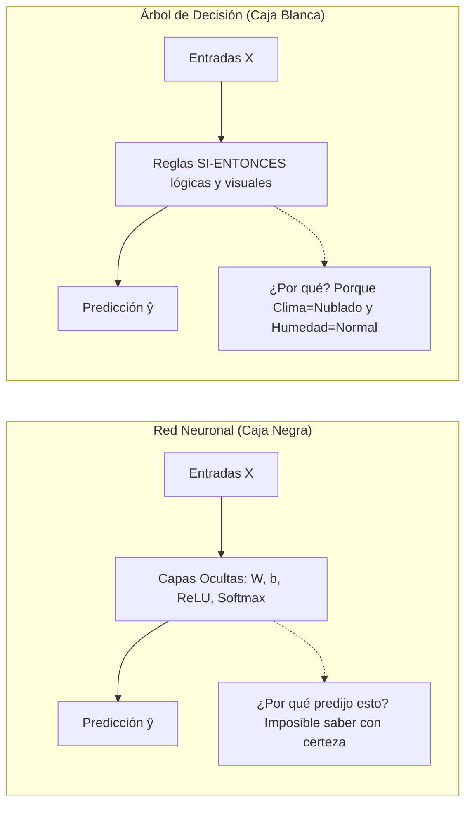
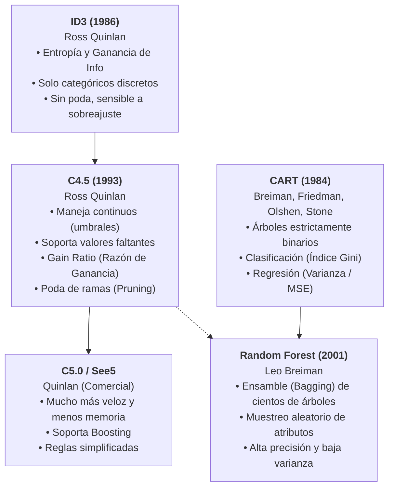
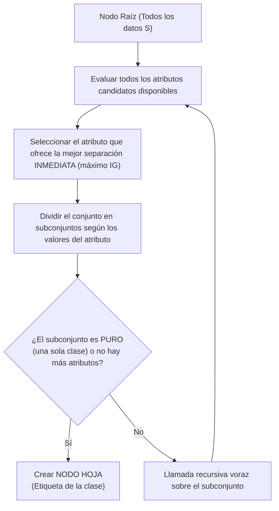
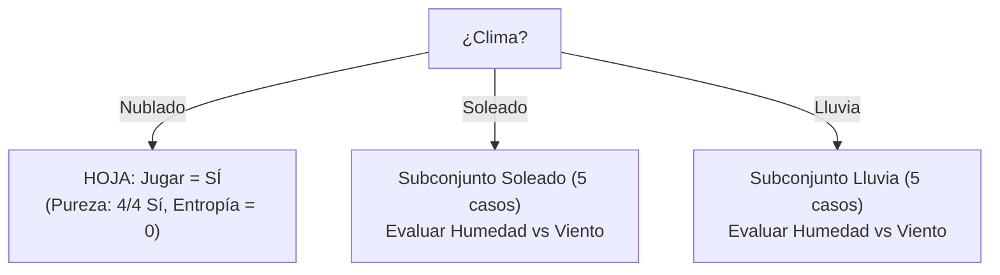
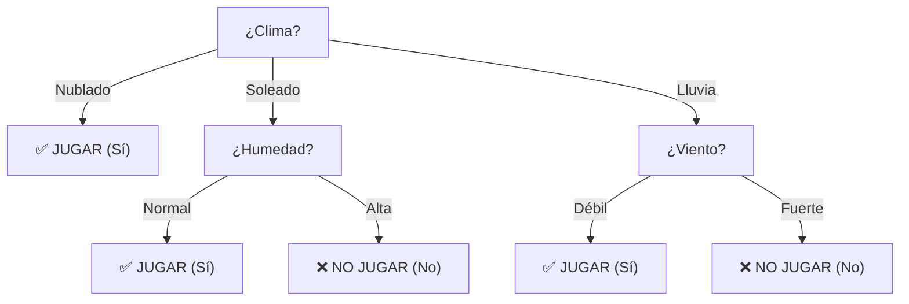

# Árboles de Decisión, Algoritmo ID3, Entropía de Shannon y Ganancia de Información
*Miércoles, 21 de octubre de 2026*

## 📌 Tareas y Elementos a Retomar
- [ ] Programar / simular el cálculo de Entropía y Ganancia de Información para validar particiones en datasets discretos. 📅 2026-10-28
- [ ] Analizar las limitaciones de ID3 frente a atributos continuos y valores faltantes (introducción a C4.5). 📅 2026-10-23
- [ ] Continuar con la redacción del reporte técnico del Parcial 1 (recordar formato pregunta-respuesta sin introducción innecesaria). 📅 2026-11-03

## Conexiones
- Evaluación con matrices de confusión y métricas de error: [[18. Métricas de Evaluación en Clasificación, Matriz de Confusión y Costos Asimétricos de Error]]
- Métodos de búsqueda heurística y espacios de estados: [[3. Elementos de los Modelos y Métodos de Búsqueda]]
- Comparación con clasificadores de frontera continua (Redes Neuronales MLP): [[15. Redes Neuronales Multicapa (MLP) y Algoritmo de Propagación Hacia Atrás (Backpropagation)]]
- Proyecto integrador del 1er parcial: [[19. Guía de Resolución del 1er Parcial - Pipeline de Clasificación de 1M Clientes con Redes Neuronales]]

---

## 1. La Gran Ventaja: Modelos de "Caja Blanca" e Interpretabilidad

A diferencia de las **Redes Neuronales Artificiales** (consideradas modelos de **caja negra** porque sus predicciones dependen de millones de multiplicaciones matriciales de pesos $W$ y sesgos $b$ que ningún ser humano puede descifrar a simple vista), los **Árboles de Decisión** son modelos de **caja blanca (*white-box*)**:



### ¿Por qué son descriptivos y legibles?
1. **Traducción directa a reglas lógicas:** Cada camino desde el nodo raíz hasta una hoja terminal equivale a una regla conjuntiva:
   $$\text{SI } (\text{Atributo}_1 = \text{Valor}_A) \text{ Y } (\text{Atributo}_2 = \text{Valor}_B) \dots \text{ ENTONCES } \text{Clase} = C$$
2. **Explicabilidad causal:** Permiten justificar ante un cliente, médico o auditor el *por qué* exacto de la decisión.
3. **Selección implícita de características:** Los atributos más discriminantes quedan colocados naturalmente cerca de la raíz; aquellos irrelevantes son descartados o quedan al fondo.

---

## 2. Genealogía y Evolución de los Algoritmos de Árboles



| Algoritmo | Creador / Año | Criterio de División | Tipo de Atributos | Estructura del Árbol | Tratamiento de Nulos y Continuos |
| :--- | :--- | :--- | :--- | :--- | :--- |
| **ID3** | Ross Quinlan (1986) | **Ganancia de Información ($IG$)** basada en Entropía de Shannon | Solo discretos / categóricos | $N$ ramas por nodo (un hijo por cada valor del atributo) | No maneja nulos ni continuos |
| **C4.5** | Ross Quinlan (1993) | **Gain Ratio** (Razón de Ganancia) | Categóricos y continuos | $N$ ramas (categóricos) o 2 ramas (continuos) | Imputa probabilísticamente y crea umbrales $X \le \theta$ |
| **C5.0** | Ross Quinlan | Gain Ratio optimizado | Categóricos y continuos | Múltiples ramas, soporte de reglas compactas | Muy eficiente en memoria y velocidad |
| **CART** | Breiman et al. (1984) | **Índice de Impureza de Gini** (clasif.) / **MSE** (regresión) | Categóricos y continuos | **Estrictamente binario** (siempre 2 ramas) | Variables sustitutas (*surrogates*) |
| **Random Forest** | Leo Breiman (2001) | Gini / Entropía / MSE | Mixtos | Ensamble de cientos de árboles CART no podados | Manejo robusto mediante agregación por votación |

---

## 3. Algoritmos Voraces (*Greedy*) y la Inducción TDIDT

Los árboles de decisión se construyen mediante un enfoque denominado **TDIDT** (*Top-Down Induction of Decision Trees*). Es un **algoritmo voraz (*greedy algorithm*)** o heurística miope:



### ¿Qué significa que sea "Voraz" (*Greedy*)?
1. **Optimización Local Inmediata:** En cada paso, el algoritmo elige el atributo que produce la mayor reducción de desorden *en ese instante*, sin considerar el impacto que esa elección tendrá en los niveles inferiores del árbol.
2. **Sin Marcha Atrás (*No Backtracking*):** Una vez que se divide un nodo por un atributo, esa decisión queda fija de por vida. El algoritmo jamás "se arrepiente" ni retrocede para probar si otra combinación de atributos hubiera generado un árbol más pequeño o con menos errores globales.
3. **¿Por qué se usa si no garantiza el óptimo global?**
   - Encontrar el árbol de decisión óptimo mínimo es un problema matemáticamente **NP-completo**. Probar todas las posibles permutaciones de árboles requeriría un tiempo exponencial inasumible ($O(2^{N})$).
   - La heurística voraz tiene costo polinomial muy bajo ($O(m \cdot n)$ donde $m$ es el número de instancias y $n$ el de atributos), y empíricamente genera árboles de excelente rendimiento.

---

## 4. Entropía de la Información (Shannon): El Termómetro del Desorden

Formulada por **Claude Shannon (1948)** en su Teoría Matemática de la Comunicación, la **Entropía $H(S)$** mide la **incertidumbre, desorden o impureza** contenida en un conjunto de datos $S$.

### La Fórmula de Shannon
$$H(S) = - \sum_{i=1}^{c} p_i \log_2(p_i)$$

Donde:
* $S$: Es el conjunto o nodo de datos actual.
* $c$: Es el número total de clases del atributo objetivo (*target*). Si el problema es binario (Sí / No, Aprobado / Reprobado, Fraude / No Fraude), entonces $c = 2$.
* **¿QUÉ ES EXACTAMENTE $p_i$?**:
  $$p_i = \frac{\text{Número de instancias de la clase } i \text{ en el conjunto } S}{|S| \text{ (Total de instancias en el conjunto } S)}$$
  > **$p_i$ es simplemente la proporción (probabilidad empírica)** que representa la clase $i$ dentro del nodo.
  > 
  > *Ejemplo rápido:* Si en un nodo hay 10 personas, y 7 pagaron su deuda mientras que 3 cayeron en impago:
  > - $p_{\text{pagó}} = \frac{7}{10} = 0.70$
  > - $p_{\text{impago}} = \frac{3}{10} = 0.30$

* **¿Por qué el signo negativo inicial $-\sum$?**:
  - Como $0 \le p_i \le 1$, el logaritmo de cualquier fracción siempre da un número negativo (ejemplo: $\log_2(0.5) = -1$).
  - Para que la medida de desorden sea un valor **positivo**, la fórmula antepone el signo menos.
* **Convención matemática fundamental:**
  $$\text{Si } p_i = 0, \quad \lim_{p_i \to 0^+} p_i \log_2(p_i) = 0$$
  *(Si no hay instancias de una clase, su contribución a la incertidumbre es cero).*

### Los Dos Extremos de la Entropía (en clasificación binaria)

```
Entropía H(S)
 1.0 |                   ╭─────────╮   <-- Máxima incertidumbre: 50% Sí / 50% No
     |                ╭──╯         ╰──╮    H(S) = 1.0 (caos total, como lanzar una moneda)
 0.8 |              ╭─╯               ╰─╮
     |             ╭╯                   ╰╮
 0.5 |            ╭╯                     ╰╮
     |           ╭╯                       ╰╮
 0.0 |───────────┴─────────────────────────┴──────────
     0.0 (100% No)           0.5           1.0 (100% Sí)
                   Proporción p de la clase Sí
```

1. **Pureza Total ($H(S) = 0$):**
   - Todas las instancias del conjunto pertenecen a una misma clase ($p_1 = 1.0, p_2 = 0$).
   - No hay ninguna incertidumbre; la respuesta se conoce con certeza absoluta.
   - El nodo se convierte de inmediato en una **hoja**.
2. **Máxima Impureza ($H(S) = 1.0$ en binario):**
   - Las instancias están repartidas exactamente 50% y 50% ($p_1 = 0.5, p_2 = 0.5$).
   - Incertidumbre total: el clasificador no tiene ninguna pista y adivinar equivale a un volado.

---

## 5. Ganancia de Información ($IG$): Criterio de Selección de ID3

¿Cuál de todos los descriptores candidatos es el mejor para colocar en el nodo actual?
El algoritmo ID3 responde: **aquel que logre la mayor reducción en el desorden del conjunto**, es decir, el que maximice la **Ganancia de Información ($IG$)**.

### Fórmula de Ganancia de Información
$$IG(S, A) = H(S) - \sum_{v \in \text{Valores}(A)} \frac{|S_v|}{|S|} H(S_v)$$

Donde:
* $H(S)$: Entropía del nodo actual (padre) **antes** de dividir.
* $A$: Atributo candidato que estamos evaluando (ej. `Clima`, `Humedad`, `Viento`).
* $\text{Valores}(A)$: El conjunto de posibles valores que puede tomar el atributo $A$ (ej. para `Clima`: $\{$Soleado, Nublado, Lluvioso$\}$).
* $S_v$: El subconjunto de instancias de $S$ donde el atributo $A$ toma el valor específico $v$.
* $\frac{|S_v|}{|S|}$: La **ponderación o peso** (qué porcentaje de los datos del padre se fueron por esa rama).
* $H(S_v)$: La entropía interna del subconjunto hijo que cayó en la rama $v$.

> **En palabras sencillas:**
> $$\text{Ganancia de Información} = (\text{Desorden que teníamos}) - (\text{Desorden promedio que nos queda después de separar})$$

El algoritmo calcula el $IG$ de **todos** los atributos independientes disponibles y escoge como nodo divisor a:
$$A^* = \arg\max_{A} IG(S, A)$$

---

## 6. Caso Práctico Completo: Cálculo Numérico Paso a Paso

Para ver cómo funciona la matemática detrás de ID3, consideremos el dataset clásico de 14 días para predecir si una persona saldrá a **Jugar Tenis** (`Target`: Sí / No).

### Datos de Entrenamiento ($S$)

| Día | Clima | Humedad | Viento | ¿Juega Tenis? (Target) |
| :---: | :---: | :---: | :---: | :---: |
| D1 | Soleado | Alta | Débil | **No** |
| D2 | Soleado | Alta | Fuerte | **No** |
| D3 | Nublado | Alta | Débil | **Sí** |
| D4 | Lluvia | Alta | Débil | **Sí** |
| D5 | Lluvia | Normal | Débil | **Sí** |
| D6 | Lluvia | Normal | Fuerte | **No** |
| D7 | Nublado | Normal | Fuerte | **Sí** |
| D8 | Soleado | Alta | Débil | **No** |
| D9 | Soleado | Normal | Débil | **Sí** |
| D10 | Lluvia | Normal | Débil | **Sí** |
| D11 | Soleado | Normal | Fuerte | **Sí** |
| D12 | Nublado | Alta | Fuerte | **Sí** |
| D13 | Nublado | Normal | Débil | **Sí** |
| D14 | Lluvia | Alta | Fuerte | **No** |

---

### PASO 1: Calcular la Entropía Inicial del Conjunto Padre $H(S)$

Total de instancias: $|S| = 14$.
* Instancias con `Juega = Sí`: $9$
* Instancias con `Juega = No`: $5$

Calculamos las proporciones $p_i$:
$$p_{\text{Sí}} = \frac{9}{14} \approx 0.6429$$
$$p_{\text{No}} = \frac{5}{14} \approx 0.3571$$

Aplicamos la fórmula de Shannon:
$$H(S) = - \left[ p_{\text{Sí}} \log_2(p_{\text{Sí}}) + p_{\text{No}} \log_2(p_{\text{No}}) \right]$$
$$H(S) = - \left[ 0.6429 \cdot \log_2(0.6429) + 0.3571 \cdot \log_2(0.3571) \right]$$

Recordando que $\log_2(x) = \frac{\ln(x)}{\ln(2)}$:
* $\log_2(0.6429) = \frac{-0.4418}{0.6931} \approx -0.6374$
* $\log_2(0.3571) = \frac{-1.0297}{0.6931} \approx -1.4854$

Sustituyendo:
$$H(S) = - \left[ 0.6429 \cdot (-0.6374) + 0.3571 \cdot (-1.4854) \right]$$
$$H(S) = - \left[ -0.4098 - 0.5305 \right] = -(-0.9403) \approx \mathbf{0.9403 \text{ bits}}$$

> **El desorden base del conjunto es $0.9403$ bits.**

---

### PASO 2: Evaluar el Atributo Candidato `Viento`

El atributo `Viento` tiene 2 valores posibles: $\{\text{Débil}, \text{Fuerte}\}$.

#### Rama 1: Viento = Débil
* Total de días con viento débil: $|S_{\text{débil}}| = 8$ (D1, D3, D4, D5, D8, D9, D10, D13)
* De esos 8 días: $6$ juegan (`Sí`) y $2$ no juegan (`No`).
* Proporciones: $p_{\text{Sí}} = \frac{6}{8} = 0.75$, $p_{\text{No}} = \frac{2}{8} = 0.25$.
$$H(S_{\text{débil}}) = - \left[ 0.75 \log_2(0.75) + 0.25 \log_2(0.25) \right]$$
$$H(S_{\text{débil}}) = - \left[ 0.75 \cdot (-0.4150) + 0.25 \cdot (-2.0000) \right] = -[-0.3113 - 0.5000] = \mathbf{0.8113 \text{ bits}}$$

#### Rama 2: Viento = Fuerte
* Total de días con viento fuerte: $|S_{\text{fuerte}}| = 6$ (D2, D6, D7, D11, D12, D14)
* De esos 6 días: $3$ juegan (`Sí`) y $3$ no juegan (`No`).
* Proporciones: $p_{\text{Sí}} = \frac{3}{6} = 0.50$, $p_{\text{No}} = \frac{3}{6} = 0.50$.
$$H(S_{\text{fuerte}}) = - \left[ 0.50 \log_2(0.50) + 0.50 \log_2(0.50) \right] = \mathbf{1.0000 \text{ bit}}$$ *(Máximo desorden: 50/50)*

#### Entropía Ponderada y Ganancia de `Viento`
$$\text{Entropía Ponderada} = \frac{|S_{\text{débil}}|}{|S|} H(S_{\text{débil}}) + \frac{|S_{\text{fuerte}}|}{|S|} H(S_{\text{fuerte}})$$
$$\text{Entropía Ponderada} = \frac{8}{14}(0.8113) + \frac{6}{14}(1.0000) = 0.4636 + 0.4286 = \mathbf{0.8922 \text{ bits}}$$

Calculamos la Ganancia de Información:
$$IG(S, \text{Viento}) = H(S) - \text{Entropía Ponderada} = 0.9403 - 0.8922 = \mathbf{0.0481 \text{ bits}}$$

---

### PASO 3: Evaluar el Atributo Candidato `Clima`

El atributo `Clima` tiene 3 valores: $\{\text{Soleado}, \text{Nublado}, \text{Lluvia}\}$.

#### Rama 1: Clima = Soleado ($|S_{\text{soleado}}| = 5$)
* Días: D1 (No), D2 (No), D8 (No), D9 (Sí), D11 (Sí) $\to 2 \text{ Sí}, 3 \text{ No}$.
* $p_{\text{Sí}} = 2/5 = 0.40$, $p_{\text{No}} = 3/5 = 0.60$.
$$H(S_{\text{soleado}}) = - [0.40 \log_2(0.40) + 0.60 \log_2(0.60)] = \mathbf{0.9710 \text{ bits}}$$

#### Rama 2: Clima = Nublado ($|S_{\text{nublado}}| = 4$)
* Días: D3 (Sí), D7 (Sí), D12 (Sí), D13 (Sí) $\to 4 \text{ Sí}, 0 \text{ No}$.
* $p_{\text{Sí}} = 4/4 = 1.0$, $p_{\text{No}} = 0/4 = 0.0$.
$$H(S_{\text{nublado}}) = - [1.0 \log_2(1.0) + 0] = \mathbf{0.0000 \text{ bits}} \quad \text{(¡SUB-CONJUNTO 100% PURO!)}$$

#### Rama 3: Clima = Lluvia ($|S_{\text{lluvia}}| = 5$)
* Días: D4 (Sí), D5 (Sí), D6 (No), D10 (Sí), D14 (No) $\to 3 \text{ Sí}, 2 \text{ No}$.
* $p_{\text{Sí}} = 3/5 = 0.60$, $p_{\text{No}} = 2/5 = 0.40$.
$$H(S_{\text{lluvia}}) = - [0.60 \log_2(0.60) + 0.40 \log_2(0.40)] = \mathbf{0.9710 \text{ bits}}$$

#### Entropía Ponderada y Ganancia de `Clima`
$$\text{Entropía Ponderada} = \frac{5}{14}(0.9710) + \frac{4}{14}(0.0000) + \frac{5}{14}(0.9710)$$
$$\text{Entropía Ponderada} = 0.3468 + 0.0000 + 0.3468 = \mathbf{0.6936 \text{ bits}}$$

Calculamos la Ganancia de Información:
$$IG(S, \text{Clima}) = 0.9403 - 0.6936 = \mathbf{0.2467 \text{ bits}}$$

---

### PASO 4: Evaluar el Atributo Candidato `Humedad`

Haciendo el mismo cálculo para `Humedad` ($\{\text{Alta}, \text{Normal}\}$):
* `Humedad = Alta` ($|S_{\text{alta}}| = 7$, $3 \text{ Sí}, 4 \text{ No}$): $H = 0.9852$
* `Humedad = Normal` ($|S_{\text{normal}}| = 7$, $6 \text{ Sí}, 1 \text{ No}$): $H = 0.5917$
* $\text{Entropía Ponderada} = \frac{7}{14}(0.9852) + \frac{7}{14}(0.5917) = 0.7885$
$$IG(S, \text{Humedad}) = 0.9403 - 0.7885 = \mathbf{0.1518 \text{ bits}}$$

---

### PASO 5: Decisión Voraz de la Raíz del Árbol

Comparamos las Ganancias de Información obtenidas:

| Atributo Candidato | Ganancia de Información ($IG$) | Posición |
| :--- | :---: | :---: |
| **`Clima`** | **$0.2467$ bits** | 🥇 **GANADOR (Mayor reducción de desorden)** |
| `Humedad` | $0.1518$ bits | 🥈 Segundo lugar |
| `Viento` | $0.0481$ bits | 🥉 Tercer lugar |

**Decisión:** El atributo **`Clima`** se convierte en el **Nodo Raíz**.



### La Recursión Voraz:
1. En la rama **Nublado**, la entropía ya es $0$ (todas las instancias son `Sí`). El algoritmo **se detiene** y crea un nodo hoja con predicción `Sí`.
2. En la rama **Soleado**, quedan 5 casos con entropía $> 0$. El algoritmo se vuelve a ejecutar recursivamente evaluando los atributos restantes (`Humedad` y `Viento`) sobre esos 5 casos. Al hacer los números, `Humedad` da $IG=0.971$ (divide perfectamente en Alta $\to$ No, Normal $\to$ Sí).
3. En la rama **Lluvia**, quedan 5 casos. Al evaluar recursivamente, `Viento` divide perfectamente (Débil $\to$ Sí, Fuerte $\to$ No).

El árbol final resultante es 100% puro y completamente interpretable:



---

## 7. Limitaciones Críticas de ID3 y el Nacimiento de C4.5

Aunque ID3 es elegante y fundamental, tiene tres debilidades graves que llevaron a Ross Quinlan a crear **C4.5**:

1. **Sesgo hacia atributos con muchos valores únicos:**
   - Si tuviéramos una columna como `ID_Cliente` o `CURP` (donde cada fila tiene un valor distinto), cada rama tendría exactamente 1 fila ($H=0$).
   - ID3 calcularía que $IG(S, \text{ID\_Cliente}) = 0.9403$ (máxima ganancia posible), colocando el ID en la raíz. El modelo memorizaría los datos (sobreajuste absoluto) pero sería inútil para predecir clientes nuevos.
   - **Solución en C4.5:** Reemplaza la Ganancia por el **Gain Ratio (Razón de Ganancia)**, normalizando $IG$ dividiéndolo entre la *Split Information* (penaliza la fragmentación excesiva).
2. **Incapacidad de manejar valores numéricos continuos:**
   - ID3 solo acepta categorías discretas.
   - **Solución en C4.5:** Ordena los valores continuos (ej. Temperatura $= [20, 22, 25, 30]$), evalúa los puntos medios como umbrales binarios ($\text{Temp} \le 23.5$) y elige el mejor umbral con base en entropía.
3. **Sobreajuste (*Overfitting*) por falta de poda:**
   - ID3 continúa dividiendo hasta que todas las ramas son puras o se acaban las variables, generando árboles monstruosos que aprenden el ruido.
   - **Solución en C4.5 / CART:** Introducen **Poda (*Pruning*)** para cortar ramas redundantes que no mejoran el desempeño en validación.
