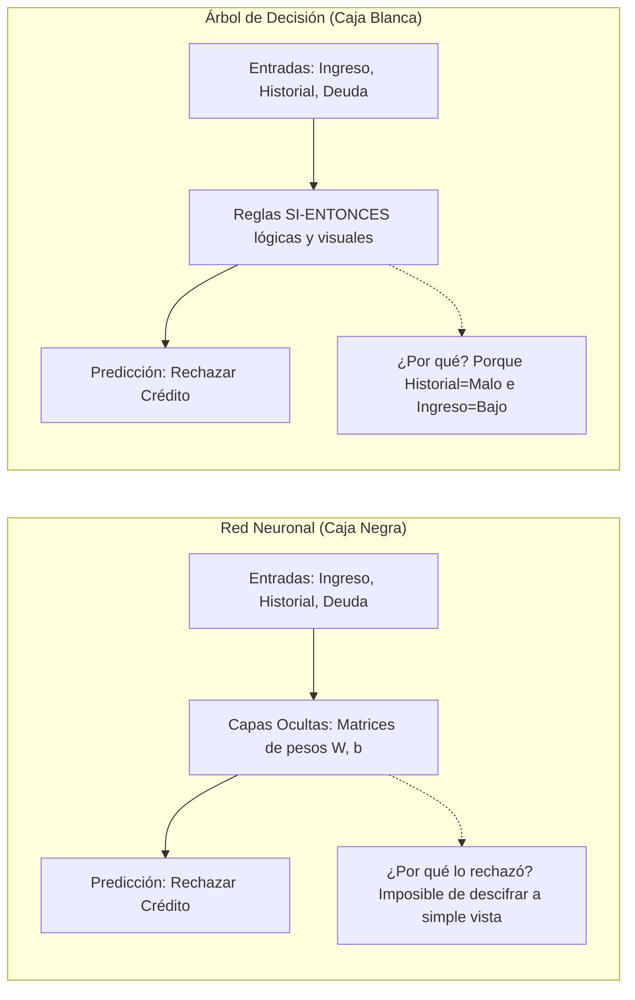
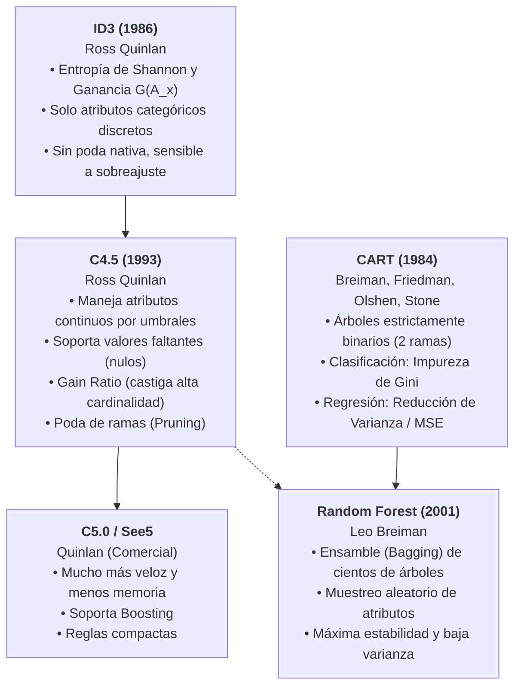
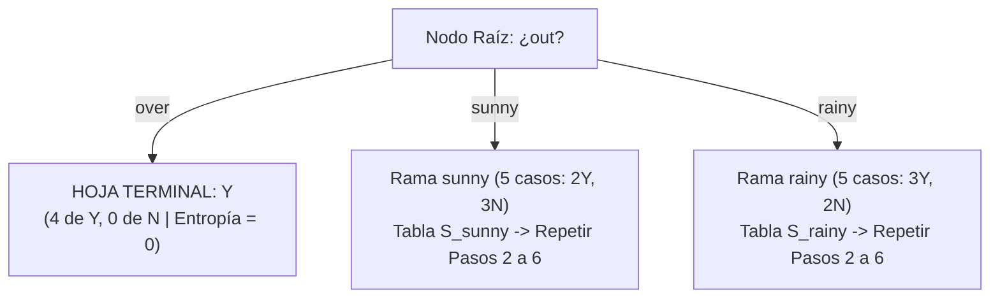
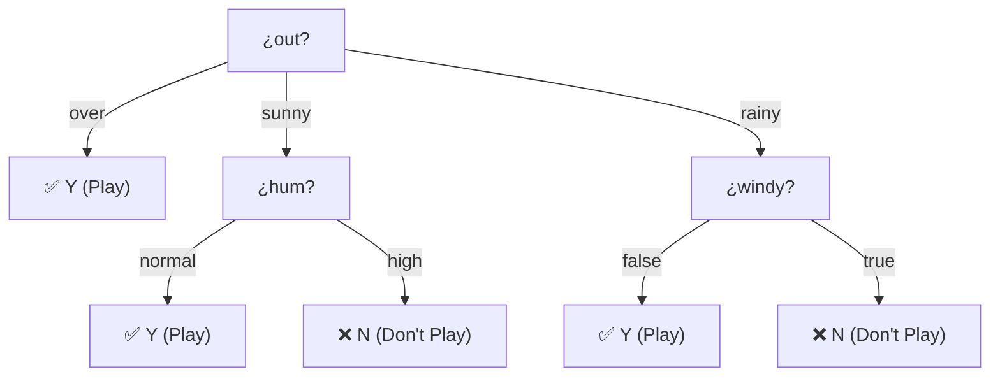

# Árboles de Decisión, Algoritmo ID3, Entropía de Shannon y Ganancia de Información
*Miércoles, 21 de octubre de 2026*

## 📌 Tareas y Elementos a Retomar
- [ ] **Tarea de clase:** calcular en papel la ganancia $G(A_x)$ de los atributos restantes (`tem`, `hum` y `windy`) siguiendo los Pasos 2 a 6 de la sección 6 y la guía de la sección 7, y comparar al final con el Paso 6. Fecha de entrega por confirmar (en clase se preguntó si podía ser el lunes). 🏷️ #minería_de_datos
- [ ] **Tarea de clase:** una vez elegido el atributo raíz, revisar si cada rama contiene registros de una sola clase (clase pura) para etiquetarla como hoja y detener ahí la expansión (Paso 7 de la sección 6 y criterios de paro de la sección 7). 🏷️ #minería_de_datos
- [ ] Programar / simular el cálculo de Entropía y Ganancia de Información para validar particiones en datasets discretos. 📅 2026-10-28
- [ ] Analizar las limitaciones de ID3 frente a atributos continuos y valores faltantes (introducción a C4.5). 📅 2026-10-23
- [ ] Continuar con la redacción del reporte técnico del Parcial 1 (recordar formato pregunta-respuesta sin introducción innecesaria). 📅 2026-11-03

## Conexiones
- Evaluación con matrices de confusión y métricas de error: [[18. Métricas de Evaluación en Clasificación, Matriz de Confusión y Costos Asimétricos de Error]]
- Métodos de búsqueda heurística y espacios de estados: [[3. Elementos de los Modelos y Métodos de Búsqueda]]
- Comparación con clasificadores de frontera continua (Redes Neuronales MLP): [[15. Redes Neuronales Multicapa (MLP) y Algoritmo de Propagación Hacia Atrás (Backpropagation)]]
- Proyecto integrador del 1er parcial: [[19. Guía de Resolución del 1er Parcial - Pipeline de Clasificación de 1M Clientes con Redes Neuronales]]
- Material del profesor: *8 INDUCCIÓN DE ÁRBOLES DE DECISION* (documento sobre ID3). Su notación ($A_x$, $S_i^x$, $\text{Pr}$, $E(A_x)$, $G(A_x)$) es la que se usa en la sección 6; lo que el documento agrega (criterios de paro y Gain Ratio) está en la sección 7.

---

## Resumen de la Clase (Grabación de Audio)

> **Nota de fidelidad:** el resumen proviene de la grabación de la sesión.
> - **Qué se hizo en clase:** el profesor explicó paso a paso cómo el algoritmo ID3 elige el atributo para cada nodo del árbol, interactuando con los alumnos en el pizarrón. Se trabajó sobre el problema clásico de predicción meteorológica (*Jugar Tenis*), cuyos atributos son `out` (clima exterior), `tem` (temperatura), `hum` (humedad) y `windy` (viento). En la grabación se mencionan los valores de `out`: `sunny` (soleado), `over` (*overcast* / nublado) y `rainy` (lluvioso).
> - **Puntos clave abordados:**
>   1. **Particionar el conjunto:** dado un atributo $A_x$, se divide la tabla $S$ en subconjuntos o bloques según cada valor de su dominio.
>   2. **Cardinalidad de cada bloque:** contar cuántos registros cayeron en cada subconjunto ($|S_i^x|$). De ahí surge la ponderación o peso $\frac{|S_i^x|}{|S|}$.
>   3. **Probabilidad de clase en cada bloque:** cuántos registros de la clase positiva y negativa hay en esa partición específica.
>   4. **Ganancia de información:** a la incertidumbre general de la tabla ($I$) se le resta la entropía ponderada del atributo ($E(A_x)$).
>   5. **Criterio de selección:** el atributo con mayor ganancia $G(A_x)$ gana la posición del nodo actual.
> - **Valores numéricos calculados en el pizarrón:** $0.940$ (información general $I$), $0.9709$ (entropía del bloque `sunny`), y $0.347$ (la aportación ponderada $\frac{5}{14} \times 0.9709$ al total de $E(\text{out})$).
> - **Alcance:** no se terminó de construir el árbol completo en clase; la tarea es calcular a mano las ganancias de los otros tres atributos.

---

## 1. ¿Qué es un Árbol de Decisión? Interpretabilidad y Modelos de "Caja Blanca"

En las sesiones anteriores trabajamos con **Redes Neuronales Artificiales** (Perceptrón y MLP). Aunque son muy potentes, tienen un defecto grave en la práctica: son **modelos de caja negra (*black-box*)**. Sus decisiones se basan en millones de pesos sinápticos ($W$) y sesgos ($b$); si una red le niega un crédito o un tratamiento médico a un paciente, ningún ser humano puede explicar con palabras sencillas cuál fue la causa exacta.

Por el contrario, los **Árboles de Decisión** son modelos de **caja blanca (*white-box*)**:



### Anatomía de un Árbol
Un árbol de clasificación está compuesto por:
1. **Nodo Raíz (*Root Node*):** El punto de partida de todos los datos. Aquí se hace la primera y más importante pregunta (por ejemplo: *¿El historial crediticio es bueno o malo?*).
2. **Nodos Internos de Decisión:** Preguntas intermedias que evalúan un atributo específico.
3. **Ramas (*Branches*):** Los caminos que se bifurcan según los posibles valores del atributo evaluado.
4. **Nodos Hoja (*Terminal Nodes / Leaves*):** Los extremos finales del árbol. Ya no hacen preguntas; contienen la **predicción final** de la clase (ejemplo: *Aprobado* o *Rechazado*).

### ¿Por qué son descriptivos y legibles?
Cualquier persona puede auditar la decisión porque cada camino desde la raíz hasta una hoja equivale a una regla lógica directa:
$$\text{SI } (\text{Historial} = \text{Bueno}) \text{ Y } (\text{Ingresos} = \text{Altos}) \longrightarrow \text{Decisión} = \text{Aprobar Crédito}$$

---

## 2. El Gran Problema: ¿Cómo Decide el Algoritmo Qué Pregunta Hacer Primero?

Imagina que tienes una tabla con 10 columnas descriptores (Edad, Salario, Deuda, Estado Civil, etc.) y quieres predecir si un cliente pagará su crédito.

Surge una pregunta fundamental:
> **¿Cuál de todas las columnas debemos poner como Nodo Raíz?**  
> ¿Empezamos preguntando por la Edad? ¿Por el Salario? ¿O por el Estado Civil?

Para responder a esto con rigor científico, necesitamos una forma matemática de medir:
1. **¿Qué tan revueltos o mezclados están los datos?** (Nivel de desorden o impureza).
2. **¿Cuál atributo logra separar mejor las clases?** (Reducción del desorden).

Aquí es donde entra la herramienta matemática central de los árboles: la **Entropía de la Información**.

---

## 3. Entropía de Shannon: El Termómetro del Desorden

Antes de calcular fórmulas, aclaremos el vocabulario básico para que nada quede "en seco".

### 3.1 ¿Qué es la Cardinalidad ($\lvert S \rvert$)?
> [!NOTE] Definición de Cardinalidad
> En teoría de conjuntos y bases de datos, la **cardinalidad** de un conjunto $S$ (simbolizada como $|S|$) es simplemente el **número total de elementos o registros** que contiene.
> * Si una tabla tiene $14$ filas de clientes, la cardinalidad de la tabla es $|S| = 14$.
> * Si filtramos los clientes que tienen `Ingresos = Alto` y encontramos $5$ personas, la cardinalidad de ese subconjunto es $|S_{\text{alto}}| = 5$.

---

### 3.2 La Intuición de la Entropía: Incertidumbre y Sorpresa
En 1948, el matemático **Claude Shannon** inventó la Teoría de la Información para responder a una duda: *¿Cuánta información transmite un mensaje?*

Shannon descubrió que la información está directamente ligada a la **sorpresa** o **incertidumbre**:
* **Cero Sorpresa (Cero Incertidumbre):** Si lanzas una moneda trucada que tiene caras en ambos lados, sabes con $100\%$ de certeza que saldrá cara. No hay ninguna sorpresa. **La entropía es $0$** (conjunto totalmente puro).
* **Máxima Sorpresa (Máxima Incertidumbre):** Si lanzas una moneda normal justa ($50\%$ cara y $50\%$ cruz), la incertidumbre es total; no tienes idea de qué va a salir. **La entropía es máxima ($1.0$ bit en problemas binarios)**.

---

### 3.3 ¿Por qué esa fórmula exactamente? (Justificación Matemática de Shannon)

La fórmula clásica de la Entropía es:
$$H(S) = - \sum_{j=1}^{t} p_j \log_2(p_j)$$

¿Por qué tiene esa estructura tan peculiar? Vamos a justificar cada parte:

#### 1. ¿Qué es $p_j$?
$p_j$ es la **proporción (probabilidad empírica)** de instancias de la clase $j$ en el conjunto actual $S$:
$$p_j = \frac{\text{Número de filas de la clase } j \text{ en } S}{|S| \text{ (Cardinalidad total de } S)}$$
Si en un grupo de 10 personas, 7 aprueban y 3 reprueban:
$$p_{\text{aprobado}} = \frac{7}{10} = 0.7, \quad p_{\text{reprobado}} = \frac{3}{10} = 0.3$$

#### 2. ¿Por qué el Logaritmo en base 2 ($\log_2$)?
En computación, la unidad básica de información es el **bit** (una pregunta binaria de Sí/No).
* Si tienes $2$ opciones equiprobables (cara o cruz), necesitas **1 pregunta binaria** para adivinar el resultado ($\log_2(2) = 1$ bit).
* Si tienes $4$ opciones equiprobables, necesitas **2 preguntas binarias** ($\log_2(4) = 2$ bits).
* Si tienes $8$ opciones equiprobables, necesitas **3 preguntas binarias** ($\log_2(8) = 3$ bits).
El logaritmo en base 2 mide exactamente **cuántas preguntas de Sí/No necesitas para resolver la incertidumbre**.

#### 3. La función de sorpresa: $-\log_2(p_j)$
Si un evento es muy común ($p = 0.99$), su sorpresa es casi nula ($-\log_2(0.99) \approx 0.01$). Si un evento es rarísimo ($p = 0.001$), su sorpresa es gigantesca ($-\log_2(0.001) \approx 9.96$ bits).

#### 4. El promedio ponderado (Esperanza matemática):
La Entropía $H(S)$ es el **promedio de sorpresa esperada** que te darán las distintas clases del conjunto:
$$H(S) = \sum_{j=1}^{t} p_j \times [\text{Sorpresa de la clase } j] = \sum_{j=1}^{t} p_j \left( -\log_2(p_j) \right) = - \sum_{j=1}^{t} p_j \log_2(p_j)$$

#### 5. ¿Por qué el signo menos afuera ($-\sum$)?
Como las probabilidades $p_j$ son números entre $0$ y $1$, el logaritmo de una fracción siempre es negativo (ejemplo: $\log_2(0.5) = -1$). Para que la medida de desorden sea un número positivo ($0$ a $1$), la fórmula multiplica por $-1$.

#### 6. Convención de cero:
Si una clase no tiene ningún registro ($p_j = 0$), no aporta ninguna incertidumbre. Matemáticamente:
$$\lim_{p \to 0^+} p \log_2(p) = 0$$

```
Entropía H(S)
 1.0 |                   ╭─────────╮   <-- Máximo desorden: 50% Clase A / 50% Clase B
     |                ╭──╯         ╰──╮    H(S) = 1.0 bit (caos total, moneda al aire)
 0.8 |              ╭─╯               ╰─╮
     |             ╭╯                   ╰╮
 0.5 |            ╭╯                     ╰╮
     |           ╭╯                       ╰╮
 0.0 |───────────┴─────────────────────────┴──────────
     0.0 (100% B, 0% A)      0.5           1.0 (100% A, 0% B)
                   Proporción p de la clase A
```

---

## 4. Ganancia de Información ($G(A_x)$) y el Enfoque Voraz (*Greedy*)

Ahora que sabemos medir el desorden con la entropía, podemos resolver el dilema del inicio: **¿qué columna hace la mejor separación?**

### 4.1 Definición de Ganancia de Información
La **Ganancia de Información ($G$)** mide cuánta incertidumbre logramos eliminar al partir la tabla usando un atributo específico $A_x$:

$$\mathbf{G(A_x) = I - E(A_x)}$$

Donde:
* **$I$ (Información general inicial):** Es la entropía total de la tabla **antes** de hacer cualquier división.
* **$E(A_x)$ (Entropía condicional del atributo):** Es el **desorden promedio que queda después** de dividir los datos entre los valores del atributo $A_x$. Se calcula promediando la entropía de cada subconjunto ponderada por su tamaño (cardinalidad):
  $$E(A_x) = \sum_{i} \left( \frac{|S_i^x|}{|S|} \right) \times H(S_i^x)$$

> **En palabras sencillas:**
> $$\text{Ganancia} = (\text{Desorden que teníamos al inicio}) - (\text{Desorden promedio que nos queda tras preguntar})$$

**El Criterio de Selección:** Se evalúan todos los atributos disponibles. Aquel que tenga la **mayor ganancia de información** (que es exactamente el que deja la **menor entropía restante**) gana y se coloca como nodo del árbol.

---

### 4.2 ¿Qué significa que el algoritmo sea Voraz (*Greedy*)?
El algoritmo construye el árbol de arriba hacia abajo (*Top-Down Induction of Decision Trees - TDIDT*):
1. **Óptimo Local Inmediato:** En cada nodo, el algoritmo elige el atributo que ofrece la mayor ganancia *en ese preciso instante*, sin preocuparse por lo que pasará en los niveles inferiores.
2. **Sin Marcha Atrás (*No Backtracking*):** Una vez que se divide por un atributo en un nodo, esa decisión queda tallada en piedra. Jamás regresa para probar otra combinación.
3. **¿Por qué se hace así?** Encontrar el árbol de decisión perfecto y más pequeño posible es un problema **NP-completo** (probar todas las combinaciones requeriría un tiempo exponencial inasumible). La heurística voraz toma decisiones en tiempo polinomial ($O(m \cdot n)$) y en la práctica produce modelos de excelente precisión.

---

## 5. Genealogía y Evolución de los Algoritmos de Árboles

Ahora que entendemos con claridad qué es la entropía, la ganancia, la cardinalidad y el enfoque voraz, tiene todo el sentido revisar cómo evolucionaron estos algoritmos en la historia de la Inteligencia Artificial:



| Algoritmo | Creador / Año | Criterio de Selección | Tipo de Variables | Forma del Árbol | Tratamiento de Nulos y Continuos |
| :--- | :--- | :--- | :--- | :--- | :--- |
| **ID3** | Ross Quinlan (1986) | **Ganancia de Información ($G$)** con Entropía de Shannon | Solo discretas / categóricas | $N$ ramas (una por cada valor del atributo) | No admite nulos ni números continuos |
| **C4.5** | Ross Quinlan (1993) | **Gain Ratio** (Razón de Ganancia) | Categóricas y continuas | $N$ ramas (discretas) o 2 ramas (continuas) | Imputación probabilística y umbrales numéricos ($X \le \theta$) |
| **C5.0** | Ross Quinlan | Gain Ratio optimizado | Categóricas y continuas | Múltiples ramas | Altamente optimizado para producción |
| **CART** | Breiman et al. (1984) | **Índice de Gini** (clasif.) / **MSE** (regresión) | Categóricas y continuas | **Estrictamente binario** (siempre 2 ramas) | Variables sustitutas (*surrogates*) |
| **Random Forest** | Leo Breiman (2001) | Gini / Entropía / MSE | Categóricas y continuas | Ensamble de cientos de árboles CART | Votación mayoritaria muy robusta ante ruido |

---

## 6. La Metodología Formal en 7 Pasos de Cátedra (Ejercicio Resuelto)

A continuación aplicamos la metodología formal de 7 pasos vista en el pizarrón sobre el dataset canónico de predicción meteorológica para decidir si se sale a **Jugar Tenis** (`play`).

### Dataset Canónico de Entrenamiento ($S$) — 14 Registros

| Registro ($k$) | Atributo $A_1$ (`out`) | Atributo $A_2$ (`tem`) | Atributo $A_3$ (`hum`) | Atributo $A_4$ (`windy`) | Clase $C$ (`play`) |
| :---: | :---: | :---: | :---: | :---: | :---: |
| 1 | `sunny` | `hot` | `high` | `false` | **N** |
| 2 | `sunny` | `hot` | `high` | `true` | **N** |
| 3 | `over` | `hot` | `high` | `false` | **Y** |
| 4 | `rainy` | `mild` | `high` | `false` | **Y** |
| 5 | `rainy` | `cool` | `normal` | `false` | **Y** |
| 6 | `rainy` | `cool` | `normal` | `true` | **N** |
| 7 | `over` | `cool` | `normal` | `true` | **Y** |
| 8 | `sunny` | `mild` | `high` | `false` | **N** |
| 9 | `sunny` | `cool` | `normal` | `false` | **Y** |
| 10 | `rainy` | `mild` | `normal` | `false` | **Y** |
| 11 | `sunny` | `mild` | `normal` | `true` | **Y** |
| 12 | `over` | `mild` | `high` | `true` | **Y** |
| 13 | `over` | `hot` | `normal` | `false` | **Y** |
| 14 | `rainy` | `mild` | `high` | `true` | **N** |

---

### Paso 1: Definir Atributos y Dominios ($A$ y $D$)
1. **Conjunto de atributos descriptores independientes:**
   $$A = \{A_1, A_2, A_3, A_4\} = \{\text{out}, \text{tem}, \text{hum}, \text{windy}\}$$
2. **Atributo objetivo (*target* / clase):** $C = \text{play}$.
3. **Dominios de cada atributo ($D(A_x)$):** Los valores posibles que puede tomar cada columna:
   * $D(A_1) = D(A_{\text{out}}) = \{v_1^1, v_2^1, v_3^1\} = \{\text{sunny}, \text{over}, \text{rainy}\}$
   * $D(A_2) = D(A_{\text{tem}}) = \{v_1^2, v_2^2, v_3^2\} = \{\text{hot}, \text{mild}, \text{cool}\}$
   * $D(A_3) = D(A_{\text{hum}}) = \{v_1^3, v_2^3\} = \{\text{high}, \text{normal}\}$
   * $D(A_4) = D(A_{\text{windy}}) = \{v_1^4, v_2^4\} = \{\text{false}, \text{true}\}$
4. **Dominio de la clase ($D(\text{play})$):**
   $$D(\text{play}) = \{v_1^c, v_2^c\} = \{Y, N\}$$

---

### Paso 2: Particionar el Conjunto de Datos ($S$) y Contar Cardinalidades
Se toma la tabla completa $S$ (cardinalidad $|S| = 14$) y se divide en bloques según los valores del atributo $A_x$:

Para $A_1$ (`out`):
1. **Partición por valor ($S_i^1$):**
   * $S_1^1$ (`sunny`): Registros $\{1, 2, 8, 9, 11\} \implies \text{cardinalidad } |S_1^1| = 5$
   * $S_2^1$ (`over`): Registros $\{3, 7, 12, 13\} \implies \text{cardinalidad } |S_2^1| = 4$
   * $S_3^1$ (`rainy`): Registros $\{4, 5, 6, 10, 14\} \implies \text{cardinalidad } |S_3^1| = 5$
2. **Sub-partición por clase ($S_j^c(S_i^1)$):**
   * En `sunny` ($5$ filas): $2$ son $Y$, $3$ son $N$.
   * En `over` ($4$ filas): $4$ son $Y$, $0$ son $N$ (¡bloque puro!).
   * En `rainy` ($5$ filas): $3$ son $Y$, $2$ son $N$.

---

### Paso 3: Derivar Todas las Probabilidades ($\text{Pr}$)
1. **Probabilidades generales de la clase $\text{Pr}(S_j^c)$:**
   * En toda la tabla ($14$ filas), hay $9$ de $Y$ y $5$ de $N$:
   $$\text{Pr}(S_1^c) = \text{Pr}(Y) = \frac{9}{14} \approx 0.6429, \quad \text{Pr}(S_2^c) = \text{Pr}(N) = \frac{5}{14} \approx 0.3571$$
2. **Probabilidades (pesos) de cada bloque $\text{Pr}(S_i^x) = \frac{|S_i^x|}{|S|}$:**
   * Para $A_1$ (`out`): $\text{Pr}(S_1^1) = \frac{5}{14}$, $\text{Pr}(S_2^1) = \frac{4}{14}$, $\text{Pr}(S_3^1) = \frac{5}{14}$
   * Para $A_2$ (`tem`): $\text{Pr}(\text{hot}) = \frac{4}{14}$, $\text{Pr}(\text{mild}) = \frac{6}{14}$, $\text{Pr}(\text{cool}) = \frac{4}{14}$
   * Para $A_3$ (`hum`): $\text{Pr}(\text{high}) = \frac{7}{14}$, $\text{Pr}(\text{normal}) = \frac{7}{14}$
   * Para $A_4$ (`windy`): $\text{Pr}(\text{false}) = \frac{8}{14}$, $\text{Pr}(\text{true}) = \frac{6}{14}$
3. **Probabilidades condicionales dentro de cada bloque $\text{Pr}(S_j^c(S_i^x)) = \frac{|S_j^c(S_i^x)|}{|S_i^x|}$:**
   * En `sunny`: $\text{Pr}(Y \mid \text{sunny}) = \frac{2}{5} = 0.4$, $\text{Pr}(N \mid \text{sunny}) = \frac{3}{5} = 0.6$
   * En `over`: $\text{Pr}(Y \mid \text{over}) = \frac{4}{4} = 1.0$, $\text{Pr}(N \mid \text{over}) = \frac{0}{4} = 0.0$
   * En `rainy`: $\text{Pr}(Y \mid \text{rainy}) = \frac{3}{5} = 0.6$, $\text{Pr}(N \mid \text{rainy}) = \frac{2}{5} = 0.4$

---

### Paso 4: Calcular la Entropía de Cada Atributo ($E(A_x)$)

Fórmula general:
$$E(A_x) = \sum_{i} \text{Pr}(S_i^x) \left[ - \sum_{j} \text{Pr}(S_j^c(S_i^x)) \cdot \log_2(\text{Pr}(S_j^c(S_i^x))) \right]$$

#### 1. Atributo $A_1$ (`out`):
* Bloque `sunny` ($5/14$, 2Y, 3N): $- [0.4 \log_2(0.4) + 0.6 \log_2(0.6)] = 0.9710$
* Bloque `over` ($4/14$, 4Y, 0N): $- [1.0 \log_2(1.0) + 0] = 0.0000$ *(Puro)*
* Bloque `rainy` ($5/14$, 3Y, 2N): $- [0.6 \log_2(0.6) + 0.4 \log_2(0.4)] = 0.9710$
$$E(A_1) = \frac{5}{14}(0.9710) + \frac{4}{14}(0.0000) + \frac{5}{14}(0.9710) = 0.3468 + 0 + 0.3468 = \mathbf{0.6935 \text{ bits}}$$

#### 2. Atributo $A_2$ (`tem`):
* Bloque `hot` ($4/14$, 2Y, 2N): $- [0.5 \log_2(0.5) + 0.5 \log_2(0.5)] = 1.0000$
* Bloque `mild` ($6/14$, 4Y, 2N): $- [\frac{4}{6} \log_2(\frac{4}{6}) + \frac{2}{6} \log_2(\frac{2}{6})] = 0.9183$
* Bloque `cool` ($4/14$, 3Y, 1N): $- [\frac{3}{4} \log_2(\frac{3}{4}) + \frac{1}{4} \log_2(\frac{1}{4})] = 0.8113$
$$E(A_2) = \frac{4}{14}(1.0000) + \frac{6}{14}(0.9183) + \frac{4}{14}(0.8113) = 0.2857 + 0.3936 + 0.2318 = \mathbf{0.9111 \text{ bits}}$$

#### 3. Atributo $A_3$ (`hum`):
* Bloque `high` ($7/14$, 3Y, 4N): $- [\frac{3}{7} \log_2(\frac{3}{7}) + \frac{4}{7} \log_2(\frac{4}{7})] = 0.9852$
* Bloque `normal` ($7/14$, 6Y, 1N): $- [\frac{6}{7} \log_2(\frac{6}{7}) + \frac{1}{7} \log_2(\frac{1}{7})] = 0.5917$
$$E(A_3) = \frac{7}{14}(0.9852) + \frac{7}{14}(0.5917) = 0.4926 + 0.2958 = \mathbf{0.7885 \text{ bits}}$$

#### 4. Atributo $A_4$ (`windy`):
* Bloque `false` ($8/14$, 6Y, 2N): $- [\frac{6}{8} \log_2(\frac{6}{8}) + \frac{2}{8} \log_2(\frac{2}{8})] = 0.8113$
* Bloque `true` ($6/14$, 3Y, 3N): $- [0.5 \log_2(0.5) + 0.5 \log_2(0.5)] = 1.0000$
$$E(A_4) = \frac{8}{14}(0.8113) + \frac{6}{14}(1.0000) = 0.4636 + 0.4286 = \mathbf{0.8922 \text{ bits}}$$

---

### Paso 5: Calcular la Información General de la Clase ($I$)
Es la entropía inicial de la columna `play` antes de dividir:
$$I = - \sum_{j=1}^{2} \text{Pr}(S_j^c) \log_2(\text{Pr}(S_j^c)) = - \left[ \frac{9}{14} \log_2\left(\frac{9}{14}\right) + \frac{5}{14} \log_2\left(\frac{5}{14}\right) \right] = \mathbf{0.9403 \text{ bits}}$$

---

### Paso 6: Calcular la Ganancia ($G(A_x)$) y Elegir el Atributo Clasificador
$$G(A_x) = I - E(A_x)$$

* $G(A_1) = G(\text{out}) = 0.9403 - 0.6935 = \mathbf{0.2467 \text{ bits}}$ 🥇 **(Mayor ganancia / menor desorden)**
* $G(A_3) = G(\text{hum}) = 0.9403 - 0.7885 = 0.1518 \text{ bits}$ 🥈
* $G(A_4) = G(\text{windy}) = 0.9403 - 0.8922 = 0.0481 \text{ bits}$ 🥉
* $G(A_2) = G(\text{tem}) = 0.9403 - 0.9111 = 0.0292 \text{ bits}$ 🎖️

**Decisión:** El atributo clasificador ganador es **$A_1$ (`out`)** con $G(A_1) = 0.2467$, por lo que se convierte en el **Nodo Raíz**.

---

### Paso 7: Construir las Ramas y Repetir Recursivamente
Dibujamos la raíz con sus 3 ramas correspondientes a $D(A_{\text{out}}) = \{\text{sunny}, \text{over}, \text{rainy}\}$:



1. **Rama `over`:** Todas las filas tienen clase $Y$ (4 $Y$, 0 $N$). Como la entropía es $0$, la rama se cierra y se etiqueta con la clase **$Y$** (nodo hoja).
2. **Rama `sunny`:** Sub-tabla de 5 filas (2 $Y$, 3 $N$). Se repiten los Pasos 2 a 6 con los atributos restantes $\{A_2, A_3, A_4\}$:
   * Información local: $I = 0.9710$ bits.
   * Al evaluar $A_3$ (`hum`): el bloque `high` tiene solo $N$ ($E=0$) y `normal` tiene solo $Y$ ($E=0$).
   * $E(A_{\text{hum}}) = 0 \implies G(A_{\text{hum}}) = 0.9710 - 0 = \mathbf{0.9710 \text{ bits}}$ (Ganador absoluto).
   * Se divide por `hum`:
     - `high` $\longrightarrow$ **Hoja $N$** (No jugar).
     - `normal` $\longrightarrow$ **Hoja $Y$** (Sí jugar).
3. **Rama `rainy`:** Sub-tabla de 5 filas (3 $Y$, 2 $N$). Se repiten los Pasos 2 a 6 con los atributos restantes $\{A_2, A_3, A_4\}$:
   * Información local: $I = 0.9710$ bits.
   * Al evaluar $A_4$ (`windy`): el bloque `false` tiene solo $Y$ ($E=0$) y `true` tiene solo $N$ ($E=0$).
   * $E(A_{\text{windy}}) = 0 \implies G(A_{\text{windy}}) = 0.9710 - 0 = \mathbf{0.9710 \text{ bits}}$ (Ganador absoluto).
   * Se divide por `windy`:
     - `false` $\longrightarrow$ **Hoja $Y$** (Sí jugar).
     - `true` $\longrightarrow$ **Hoja $N$** (No jugar).

#### Árbol de Clasificación Final Inducido por ID3



---

## 7. Guía para Calcular Ganancias en Papel y Criterios de Paro del Profesor

### 7.1 ¿Qué se intenta hacer en el examen?
ID3 construye el árbol haciendo **una pregunta por nodo** (por ejemplo, "¿`out` es sunny, over o rainy?"). Para decidir cuál pregunta va primero, mide qué tanto **desorden** ($I$) queda en la clase `play` **después** de preguntar por cada atributo ($E(A_x)$). La pregunta que más desorden elimina, es decir la de mayor $G(A_x) = I - E(A_x)$, se coloca en el nodo. Luego se repite lo mismo dentro de cada rama.

### 7.2 Receta para un atributo (con `tem` como ejemplo)
1. **Tabla de conteo.** Una fila por cada valor del atributo y una columna por cada clase. Se obtiene recorriendo los 14 registros y haciendo una marca en la celda que corresponda:

| Valor de `tem` | Y | N | Total del bloque $\lvert S_i^x\rvert$ |
| :---: | :---: | :---: | :---: |
| `hot` | 2 | 2 | 4 |
| `mild` | 4 | 2 | 6 |
| `cool` | 3 | 1 | 4 |
| **Suma** | **9** | **5** | **14** |

2. **Verificar la tabla:** la columna Y debe sumar 9, la columna N debe sumar 5 y los totales deben sumar 14. Si no cuadra, se contó mal algún registro.
3. **Entropía de cada fila** (la entropía de Shannon aplicada solo a los registros de ese bloque).
4. **Peso de cada fila:** $\text{Pr}(S_i^x) = \frac{\text{total de la fila}}{14}$.
5. **Entropía del atributo:** $E(A_x) = \sum (\text{peso} \times \text{entropía de la fila})$.
6. **Ganancia:** $G(A_x) = I - E(A_x)$, con $I = 0.9403$ para este dataset.

Para `tem`: $E = \frac{4}{14}(1.0000) + \frac{6}{14}(0.9183) + \frac{4}{14}(0.8113) = 0.9111$, y $G = 0.9403 - 0.9111 = 0.0292$.

### 7.3 Truco para calcular la entropía de un bloque sin sacar proporciones
Para un bloque con $a$ registros de una clase y $b$ de la otra, con $n = a + b$, se puede trabajar directo con los conteos:
$$H(a, b) = \log_2 n - \frac{a \log_2 a + b \log_2 b}{n}$$

Valores clave para tener a la mano en el examen:

| $k$ | 1 | 2 | 3 | 4 | 5 | 6 | 7 | 8 |
| :---: | :---: | :---: | :---: | :---: | :---: | :---: | :---: | :---: | :---: |
| $\log_2 k$ | 0 | 1 | 1.585 | 2 | 2.322 | 2.585 | 2.807 | 3 |
| $k \log_2 k$ | 0 | 2 | 4.755 | 8 | 11.610 | 15.510 | 19.651 | 24 |

Comprobación con los bloques de `tem`:
* `hot` (2, 2): $n = 4$, $H = 2 - \frac{2 + 2}{4} = 1.0000$
* `mild` (4, 2): $n = 6$, $H = 2.585 - \frac{8 + 2}{6} = 0.9183$
* `cool` (3, 1): $n = 4$, $H = 2 - \frac{4.755 + 0}{4} = 0.8113$

Con esta fórmula, $H(2, 3) = 2.322 - \frac{2 + 4.755}{5} = 0.9710$ (el $0.9709$ que se mencionó en clase es el mismo valor con un decimal menos de redondeo).

### 7.4 Lista de verificación al terminar
- [ ] Cada tabla de conteo suma 14 en total, 9 en Y y 5 en N.
- [ ] Los pesos de un mismo atributo suman 1 (por ejemplo, $\frac{4}{14} + \frac{6}{14} + \frac{4}{14} = 1$).
- [ ] Cada entropía de bloque está entre 0 y 1 (con dos clases). Un bloque puro da 0 y un bloque 50/50 da 1.
- [ ] $E(A_x) \le I$ y $G(A_x) \ge 0$. Si sale una ganancia negativa, hay un error de cuenta.
- [ ] Una ganancia cercana a cero significa que el atributo casi no reduce el desorden, como `tem` con 0.0292.
- [ ] **Error frecuente:** confundir $\text{Pr}(S_i^x)$ (el peso del bloque, sobre los 14 registros) con $\text{Pr}(S_j^c(S_i^x))$ (la proporción de una clase dentro del bloque, sobre los registros del bloque).

### 7.5 Cuándo se detiene una rama (según el documento del profesor)
El documento del profesor indica que ID3 termina cuando todas las ramas concluyen en nodos de una sola clase **o** cuando ya no quedan atributos por usar ($A' = \emptyset$).

| Situación en la rama | Qué se hace |
| :--- | :--- |
| Todos los registros son de una clase (clase pura) | Se etiqueta la rama con esa clase, se cierra y se sigue con la rama hermana |
| Quedan registros mezclados y todavía hay atributos | Se repiten los Pasos 2 a 6 solo con los registros de esa rama y sin el atributo ya usado: $A' \leftarrow A' - \{A_g\}$ |
| Ya no quedan atributos ($A' = \emptyset$) | No se puede dividir más. Lo usual es etiquetar con la clase mayoritaria |
| **Criterio de tolerancia (umbral):** la clase mayoritaria supera un valor fijado de antemano | Se etiqueta con esa clase aunque la rama no sea totalmente pura. Sirve para evitar el sobreajuste |

### 7.6 Gain Ratio ($G'$): corrección para la alta cardinalidad
El documento señala que la ganancia estándar favorece a los atributos que tienen muchos valores en su dominio (alta cardinalidad). Si hubiera una columna `ID_Cliente`, ID3 la pondría como raíz memorizando los datos pero sin aprender nada útil.

Para corregirlo, se divide la ganancia entre la entropía de los propios pesos de las particiones:
$$G'(A_x) = \frac{G(A_x)}{I(\text{Pr}(S_1^x), \text{Pr}(S_2^x), \dots, \text{Pr}(S_q^x))}$$
El denominador se conoce como *Split Information* y es la mejora introducida en C4.5.

| Atributo | $G(A_x)$ | Split Information | $G'(A_x)$ |
| :--- | :---: | :---: | :---: |
| `out` | 0.2467 | 1.5774 | 0.1564 |
| `hum` | 0.1518 | 1.0000 | 0.1518 |
| `windy` | 0.0481 | 0.9852 | 0.0488 |
| `tem` | 0.0292 | 1.5567 | 0.0188 |

En este dataset el orden de los atributos no cambia al usar $G'$, y `out` sigue siendo la raíz indiscutible.
