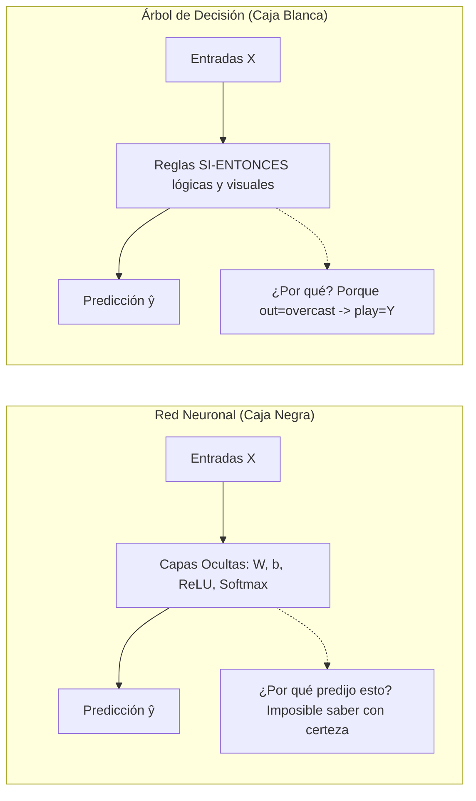
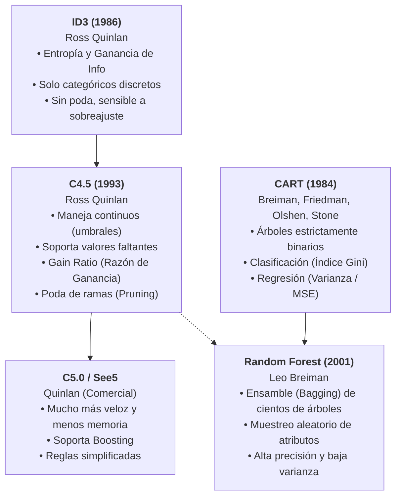
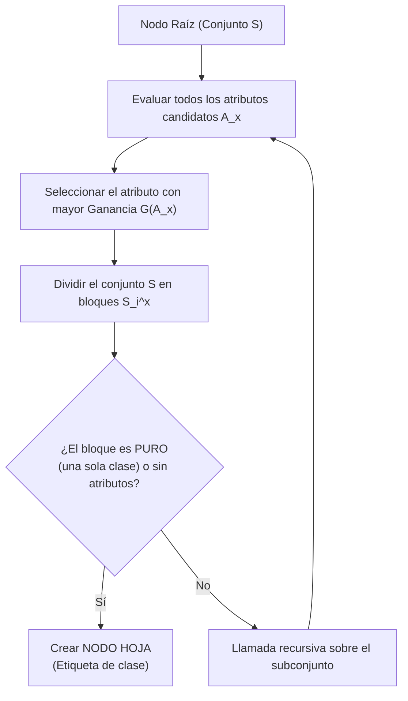
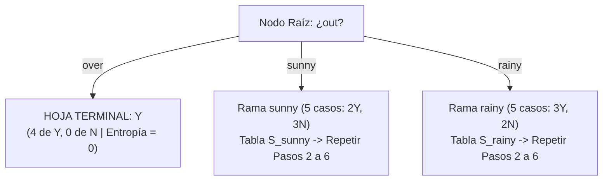
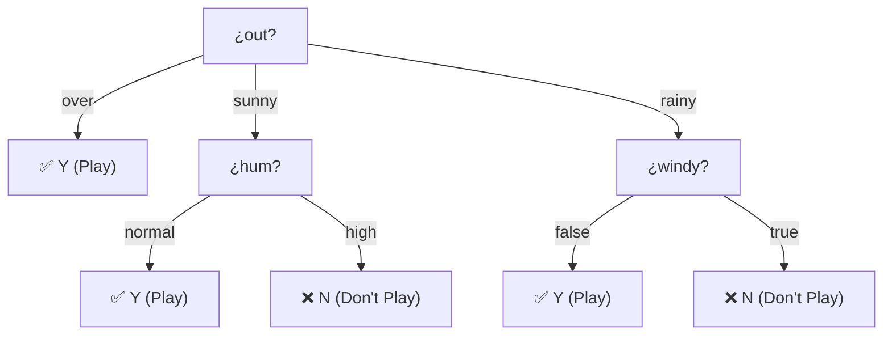

# Árboles de Decisión, Algoritmo ID3, Entropía de Shannon y Ganancia de Información
*Miércoles, 21 de octubre de 2026*

## 📌 Tareas y Elementos a Retomar
- [ ] **Tarea de clase:** calcular en papel la ganancia $G(A_x)$ de los atributos restantes (`tem`, `hum` y `windy`) siguiendo los Pasos 2 a 6 de la sección 5 y la guía de la sección 7, y comparar al final con el Paso 6. Fecha de entrega por confirmar (en clase se preguntó si podía ser el lunes). 🏷️ #minería_de_datos
- [ ] **Tarea de clase:** una vez elegido el atributo raíz, revisar si cada rama contiene registros de una sola clase (clase pura) para etiquetarla como hoja y detener ahí la expansión (Paso 7 de la sección 5 y criterios de paro de la sección 7). 🏷️ #minería_de_datos
- [ ] Programar / simular el cálculo de Entropía y Ganancia de Información para validar particiones en datasets discretos. 📅 2026-10-28
- [ ] Analizar las limitaciones de ID3 frente a atributos continuos y valores faltantes (introducción a C4.5). 📅 2026-10-23
- [ ] Continuar con la redacción del reporte técnico del Parcial 1 (recordar formato pregunta-respuesta sin introducción innecesaria). 📅 2026-11-03

## Conexiones
- Evaluación con matrices de confusión y métricas de error: [[18. Métricas de Evaluación en Clasificación, Matriz de Confusión y Costos Asimétricos de Error]]
- Métodos de búsqueda heurística y espacios de estados: [[3. Elementos de los Modelos y Métodos de Búsqueda]]
- Comparación con clasificadores de frontera continua (Redes Neuronales MLP): [[15. Redes Neuronales Multicapa (MLP) y Algoritmo de Propagación Hacia Atrás (Backpropagation)]]
- Proyecto integrador del 1er parcial: [[19. Guía de Resolución del 1er Parcial - Pipeline de Clasificación de 1M Clientes con Redes Neuronales]]
- Material del profesor: *8 INDUCCIÓN DE ÁRBOLES DE DECISION* (documento sobre ID3). Su notación ($A_x$, $S_i^x$, $\text{Pr}$, $E(A_x)$, $G(A_x)$) es la que se usa en la sección 5; lo que el documento agrega (criterios de paro y Gain Ratio) está en la sección 7.

---

## Resumen de la Clase (Audio)

> **Nota de fidelidad:** el resumen proviene de una transcripción automática con algunos términos mal reconocidos. Lo que se interpretó o se infirió está marcado como tal.

**Qué se hizo en clase:** el profesor explicó paso a paso cómo ID3 elige el atributo de cada nodo, preguntando a los estudiantes para verificar que seguían el razonamiento. Se trabajó sobre el dataset de Jugar Tenis (sección 5), cuyos atributos son `out`, `tem`, `hum` y `windy`. En la transcripción aparecen "Sunny", "Power Max" y "Rain"; se interpreta que son `sunny`, `over` (*overcast*) y `rainy`, los tres valores de `out`. "Power Max" es la lectura menos segura.

**Ideas que se cubrieron:**
1. **Particionar el conjunto:** dado un atributo $A_x$, se divide $S$ en un subconjunto por cada valor de su dominio $D(A_x)$. Si el dominio tiene 3 valores, salen 3 particiones ($S_1, S_2, S_3$).
2. **Cardinalidad de cada partición:** se cuenta cuántos registros cayeron en cada subconjunto. De ahí sale el peso $\frac{|S_j|}{|S|}$.
3. **Probabilidad de cada clase dentro de una partición:** es la proporción de registros de esa clase entre los registros de la partición (el $p_i$ de la entropía, calculado dentro de cada rama).
4. **Ganancia de información:** a la información general de la clase $I$ se le resta la entropía del atributo $E(A_x)$ (la entropía ponderada de sus particiones). En el audio se dijo "se suman las probabilidades de los conjuntos condicionales"; lo que se suma son las entropías de cada partición multiplicadas por su peso, y ese total es lo que se resta.
5. **Elección del ganador:** el atributo con mayor ganancia pasa a ser el nodo raíz. Si dos atributos empatan en ganancia, aportan lo mismo y puede elegirse cualquiera.
6. **Después de elegir la raíz:** se mira cada rama; si todos sus registros son de una sola clase, se etiqueta como hoja y esa rama se detiene.
7. **El árbol depende de los datos de entrenamiento:** con otros datos, el árbol resultante puede ser distinto.

**Valores numéricos que se calcularon en clase:** $0.940$, $0.9709$ y $0.347$.
- $0.940$ es la información general de la clase, $I$ (Paso 5 de la sección 5).
- $0.9709$ es la entropía de la rama `out = sunny` (2 Y y 3 N).
- $0.347$ coincide con $\frac{5}{14} \times 0.9709 = 0.3468$, la aportación de esa rama a la entropía $E(\text{out})$.

Por lo tanto, **se infiere** que en clase se avanzó con los cálculos del atributo `out`. El audio no lo dice de forma explícita.

**Alcance de la actividad:** el profesor indicó que no se pedirá construir el árbol completo en la sesión. La tarea es calcular en papel las ganancias de los demás atributos (ver Tareas arriba y las secciones 5 y 7).

---

## 1. La Gran Ventaja: Modelos de "Caja Blanca" e Interpretabilidad

A diferencia de las **Redes Neuronales Artificiales** (consideradas modelos de **caja negra** porque sus predicciones dependen de millones de multiplicaciones matriciales de pesos $W$ y sesgos $b$ que ningún ser humano puede descifrar a simple vista), los **Árboles de Decisión** son modelos de **caja blanca (*white-box*)**:

### ¿Por qué son descriptivos y legibles?
1. **Traducción directa a reglas lógicas:** Cada camino desde el nodo raíz hasta una hoja terminal equivale a una regla conjuntiva:
   $$\text{SI } (A_1 = v_i^1) \text{ Y } (A_2 = v_k^2) \dots \text{ ENTONCES } \text{Clase} = C$$
2. **Explicabilidad causal:** Permiten justificar ante un cliente, médico o auditor el *por qué* exacto de la decisión.
3. **Selección implícita de características:** Los atributos más discriminantes quedan colocados naturalmente cerca de la raíz; aquellos irrelevantes son descartados o quedan al fondo.

---

## 2. Genealogía y Evolución de los Algoritmos de Árboles

| Algoritmo | Creador / Año | Criterio de División | Tipo de Atributos | Estructura del Árbol | Tratamiento de Nulos y Continuos |
| :--- | :--- | :--- | :--- | :--- | :--- |
| **ID3** | Ross Quinlan (1986) | **Ganancia de Información ($G(A_x)$)** basada en Entropía | Solo discretos / categóricos | $N$ ramas por nodo (un hijo por cada valor del atributo) | No maneja nulos ni continuos |
| **C4.5** | Ross Quinlan (1993) | **Gain Ratio** (Razón de Ganancia) | Categóricos y continuos | $N$ ramas (categóricos) o 2 ramas (continuos) | Imputa probabilísticamente y crea umbrales $X \le \theta$ |
| **C5.0** | Ross Quinlan | Gain Ratio optimizado | Categóricos y continuos | Múltiples ramas, soporte de reglas compactas | Muy eficiente en memoria y velocidad |
| **CART** | Breiman et al. (1984) | **Índice de Impureza de Gini** (clasif.) / **MSE** (regresión) | Categóricos y continuos | **Estrictamente binario** (siempre 2 ramas) | Variables sustitutas (*surrogates*) |
| **Random Forest** | Leo Breiman (2001) | Gini / Entropía / MSE | Mixtos | Ensamble de cientos de árboles CART no podados | Manejo robusto mediante agregación por votación |

---

## 3. Algoritmos Voraces (*Greedy*) y la Inducción TDIDT

Los árboles de decisión se construyen mediante un enfoque denominado **TDIDT** (*Top-Down Induction of Decision Trees*). Es un **algoritmo voraz (*greedy algorithm*)** o heurística miope:

### ¿Qué significa que sea "Voraz" (*Greedy*)?
1. **Optimización Local Inmediata:** En cada paso, el algoritmo elige el atributo que produce la mayor reducción de desorden *en ese instante*, sin considerar el impacto que esa elección tendrá en los niveles inferiores del árbol.
2. **Sin Marcha Atrás (*No Backtracking*):** Una vez que se divide un nodo por un atributo, esa decisión queda fija de por vida. El algoritmo jamás "se arrepiente" ni retrocede para probar si otra combinación de atributos hubiera generado un árbol más pequeño o con menos errores globales.
3. **¿Por qué se usa si no garantiza el óptimo global?**
   - Encontrar el árbol de decisión óptimo mínimo es un problema matemáticamente **NP-completo**. Probar todas las posibles permutaciones de árboles requeriría un tiempo exponencial inasumible ($O(2^{N})$).
   - La heurística voraz tiene costo polinomial muy bajo ($O(m \cdot n)$ donde $m$ es el número de instancias y $n$ el de atributos), y empíricamente genera árboles de excelente rendimiento.

---

## 4. Entropía de la Información (Shannon): El Termómetro del Desorden

Formulada por **Claude Shannon (1948)** en su Teoría Matemática de la Comunicación, la **Entropía** mide la **incertidumbre, desorden o impureza** contenida en una distribución de probabilidades de clases:

### La Fórmula de Shannon
$$I(\text{Pr}(S_1^c), \dots, \text{Pr}(S_t^c)) = - \sum_{j=1}^{t} \text{Pr}(S_j^c) \cdot \log_2(\text{Pr}(S_j^c))$$

Donde:
* $S$: Es el conjunto o nodo de datos actual.
* $t$: Es el número total de clases del atributo objetivo (*target*). En clasificación binaria ($Y / N$), $t = 2$.
* **¿QUÉ ES EXACTAMENTE $\text{Pr}(S_j^c)$ (o $p_i$)?**:
  $$\text{Pr}(S_j^c) = \frac{\text{Número de instancias de la clase } j \text{ en } S}{|S| \text{ (Total de instancias en } S)}$$
  > **$\text{Pr}(S_j^c)$ es simplemente la proporción (probabilidad empírica)** que representa la clase $j$ dentro del conjunto.
* **¿Por qué el signo negativo inicial $-\sum$?**:
  - Como $0 \le \text{Pr}(S_j^c) \le 1$, el logaritmo de cualquier fracción siempre da un número negativo (ejemplo: $\log_2(0.5) = -1$).
  - Para que la medida de desorden sea un valor **positivo**, la fórmula antepone el signo menos.
* **Convención matemática fundamental:**
  $$\text{Si } \text{Pr} = 0, \quad \lim_{\text{Pr} \to 0^+} \text{Pr} \cdot \log_2(\text{Pr}) = 0$$

---

## 5. La Metodología Formal en 7 Pasos de Cátedra

Esta es la estructura formal que se desarrolla paso a paso en el pizarrón:

### Dataset Canónico de Entrenamiento ($S$) — 14 Instancias

| Registro ($k$) | Atributo $A_1$ (`out`) | Atributo $A_2$ (`tem`) | Atributo $A_3$ (`hum`) | Atributo $A_4$ (`windy`) | Clase $C$ (`play`) |
| :---: | :---: | :---: | :---: | :---: | :---: |
| 1 | `sunny` | `hot` | `high` | `false` | **N** |
| 2 | `sunny` | `hot` | `high` | `true` | **N** |
| 3 | `over` | `hot` | `high` | `false` | **Y** |
| 4 | `rainy` | `mild` | `high` | `false` | **Y** |
| 5 | `rainy` | `cool` | `normal` | `false` | **Y** |
| 6 | `rainy` | `cool` | `normal` | `true` | **N** |
| 7 | `over` | `cool` | `normal` | `true` | **Y** |
| 8 | `sunny` | `mild` | `high` | `false` | **N** |
| 9 | `sunny` | `cool` | `normal` | `false` | **Y** |
| 10 | `rainy` | `mild` | `normal` | `false` | **Y** |
| 11 | `sunny` | `mild` | `normal` | `true` | **Y** |
| 12 | `over` | `mild` | `high` | `true` | **Y** |
| 13 | `over` | `hot` | `normal` | `false` | **Y** |
| 14 | `rainy` | `mild` | `high` | `true` | **N** |

---

### Paso 1: Definir Atributos y Dominios ($A$ y $D$)
Antes de hacer cualquier cuenta, se estructura formalmente la tabla de datos:
1. **Conjunto de atributos descriptores ($A$):** Se enlistan las columnas que servirán como preguntas:
   $$A = \{A_1, A_2, A_3, A_4\} = \{\text{out}, \text{tem}, \text{hum}, \text{windy}\}$$
2. **Atributo objetivo (*target* / clase):** $C = \text{play}$.
3. **Dominios de cada atributo ($D(A_x)$):** Se definen los valores posibles $v_i^x$ que puede tomar cada columna:
   * $D(A_1) = D(A_{\text{out}}) = \{v_1^1, v_2^1, v_3^1\} = \{\text{sunny}, \text{over}, \text{rainy}\}$
   * $D(A_2) = D(A_{\text{tem}}) = \{v_1^2, v_2^2, v_3^2\} = \{\text{hot}, \text{mild}, \text{cool}\}$
   * $D(A_3) = D(A_{\text{hum}}) = \{v_1^3, v_2^3\} = \{\text{high}, \text{normal}\}$
   * $D(A_4) = D(A_{\text{windy}}) = \{v_1^4, v_2^4\} = \{\text{false}, \text{true}\}$
4. **Dominio de la clase ($D(\text{play})$):** Se definen los resultados posibles $v_j^c$ de la variable a predecir:
   $$D(\text{play}) = \{v_1^c, v_2^c\} = \{Y, N\}$$

---

### Paso 2: Particionar el Conjunto de Datos ($S$)
Para evaluar un atributo $A_x$, se toma toda la tabla $S$ ($|S| = 14$) y se agrupa en dos niveles:
1. **Partición por valor del atributo ($S_i^x$):** Se divide $S$ en bloques según los valores $v_i^x$ del atributo:
   * Para $A_1$ (`out`):
     - $S_1^1$ (`sunny`): Registros $\{1, 2, 8, 9, 11\} \implies |S_1^1| = 5$
     - $S_2^1$ (`over`): Registros $\{3, 7, 12, 13\} \implies |S_2^1| = 4$
     - $S_3^1$ (`rainy`): Registros $\{4, 5, 6, 10, 14\} \implies |S_3^1| = 5$
2. **Sub-partición por clase ($S_j^c(S_i^x)$):** Dentro de cada bloque $S_i^x$, se separan los registros que pertenecen a la clase $Y$ ($S_1^c$) y los que pertenecen a la clase $N$ ($S_2^c$):
   * En $S_1^1$ (`sunny`): $S_1^c(S_1^1) = 2 \text{ (Y)}$, $S_2^c(S_1^1) = 3 \text{ (N)}$
   * En $S_2^1$ (`over`): $S_1^c(S_2^1) = 4 \text{ (Y)}$, $S_2^c(S_2^1) = 0 \text{ (N)}$
   * En $S_3^1$ (`rainy`): $S_1^c(S_3^1) = 3 \text{ (Y)}$, $S_2^c(S_3^1) = 2 \text{ (N)}$

---

### Paso 3: Derivar Todas las Probabilidades ($\text{Pr}$)
Con los bloques ya armados y contados, se calculan tres tipos de probabilidades:

1. **Probabilidad de cada bloque del atributo $\text{Pr}(S_i^x)$:**
   $$\text{Pr}(S_i^x) = \frac{|S_i^x|}{|S|}$$
   * Para $A_1$ (`out`): $\text{Pr}(S_1^1) = \frac{5}{14}$, $\text{Pr}(S_2^1) = \frac{4}{14}$, $\text{Pr}(S_3^1) = \frac{5}{14}$
   * Para $A_2$ (`tem`): $\text{Pr}(S_1^2) = \frac{4}{14}$ (`hot`), $\text{Pr}(S_2^2) = \frac{6}{14}$ (`mild`), $\text{Pr}(S_3^2) = \frac{4}{14}$ (`cool`)
   * Para $A_3$ (`hum`): $\text{Pr}(S_1^3) = \frac{7}{14}$ (`high`), $\text{Pr}(S_2^3) = \frac{7}{14}$ (`normal`)
   * Para $A_4$ (`windy`): $\text{Pr}(S_1^4) = \frac{8}{14}$ (`false`), $\text{Pr}(S_2^4) = \frac{6}{14}$ (`true`)

2. **Probabilidades condicionales de clase $\text{Pr}(S_j^c(S_i^x))$:**
   $$\text{Pr}(S_j^c(S_i^x)) = \frac{|S_j^c(S_i^x)|}{|S_i^x|}$$
   * En `sunny`: $\text{Pr}(Y \mid \text{sunny}) = \frac{2}{5} = 0.4$, $\text{Pr}(N \mid \text{sunny}) = \frac{3}{5} = 0.6$
   * En `over`: $\text{Pr}(Y \mid \text{over}) = \frac{4}{4} = 1.0$, $\text{Pr}(N \mid \text{over}) = \frac{0}{4} = 0.0$
   * En `rainy`: $\text{Pr}(Y \mid \text{rainy}) = \frac{3}{5} = 0.6$, $\text{Pr}(N \mid \text{rainy}) = \frac{2}{5} = 0.4$

3. **Probabilidades generales de la clase $\text{Pr}(S_i^c)$:**
   $$\text{Pr}(S_1^c) = \text{Pr}(Y) = \frac{9}{14} \approx 0.6429, \quad \text{Pr}(S_2^c) = \text{Pr}(N) = \frac{5}{14} \approx 0.3571$$

---

### Paso 4: Calcular la Entropía de Cada Atributo ($E(A_x)$)
Usando las probabilidades del Paso 3, se calcula el desorden promedio que deja el atributo $A_x$ sumando la entropía interna de cada uno de sus bloques multiplicada por el peso de ese bloque:
$$E(A_x) = \sum_{i} \text{Pr}(S_i^x) \left[ - \sum_{j} \text{Pr}(S_j^c(S_i^x)) \cdot \log_2(\text{Pr}(S_j^c(S_i^x))) \right]$$

#### 1. Atributo $A_1$ (`out`):
* `sunny` ($5/14$): $- [0.4 \log_2(0.4) + 0.6 \log_2(0.6)] = 0.9710$
* `over` ($4/14$): $- [1.0 \log_2(1.0) + 0] = 0.0000$ *(Puro)*
* `rainy` ($5/14$): $- [0.6 \log_2(0.6) + 0.4 \log_2(0.4)] = 0.9710$
$$E(A_1) = \frac{5}{14}(0.9710) + \frac{4}{14}(0.0000) + \frac{5}{14}(0.9710) = \mathbf{0.6935 \text{ bits}}$$

#### 2. Atributo $A_2$ (`tem`):
* `hot` ($4/14$, 2Y, 2N): $- [0.5 \log_2(0.5) + 0.5 \log_2(0.5)] = 1.0000$
* `mild` ($6/14$, 4Y, 2N): $- [\frac{4}{6} \log_2(\frac{4}{6}) + \frac{2}{6} \log_2(\frac{2}{6})] = 0.9183$
* `cool` ($4/14$, 3Y, 1N): $- [\frac{3}{4} \log_2(\frac{3}{4}) + \frac{1}{4} \log_2(\frac{1}{4})] = 0.8113$
$$E(A_2) = \frac{4}{14}(1.0000) + \frac{6}{14}(0.9183) + \frac{4}{14}(0.8113) = \mathbf{0.9111 \text{ bits}}$$

#### 3. Atributo $A_3$ (`hum`):
* `high` ($7/14$, 3Y, 4N): $- [\frac{3}{7} \log_2(\frac{3}{7}) + \frac{4}{7} \log_2(\frac{4}{7})] = 0.9852$
* `normal` ($7/14$, 6Y, 1N): $- [\frac{6}{7} \log_2(\frac{6}{7}) + \frac{1}{7} \log_2(\frac{1}{7})] = 0.5917$
$$E(A_3) = \frac{7}{14}(0.9852) + \frac{7}{14}(0.5917) = \mathbf{0.7885 \text{ bits}}$$

#### 4. Atributo $A_4$ (`windy`):
* `false` ($8/14$, 6Y, 2N): $- [\frac{6}{8} \log_2(\frac{6}{8}) + \frac{2}{8} \log_2(\frac{2}{8})] = 0.8113$
* `true` ($6/14$, 3Y, 3N): $- [0.5 \log_2(0.5) + 0.5 \log_2(0.5)] = 1.0000$
$$E(A_4) = \frac{8}{14}(0.8113) + \frac{6}{14}(1.0000) = \mathbf{0.8922 \text{ bits}}$$

---

### Paso 5: Calcular la Información General de la Clase ($I$)
Usando las probabilidades generales de la clase (Paso 3, punto 3), se calcula el desorden total de la tabla antes de hacer cualquier partición:
$$I(\text{Pr}(S_1^c), \dots, \text{Pr}(S_t^c)) = - \sum_{i=1}^{t} \text{Pr}(S_i^c) \cdot \log_2(\text{Pr}(S_i^c))$$
$$I = - \left[ \frac{9}{14} \log_2\left(\frac{9}{14}\right) + \frac{5}{14} \log_2\left(\frac{5}{14}\right) \right] = \mathbf{0.9403 \text{ bits}}$$

---

### Paso 6: Calcular la Ganancia ($G(A_x)$) y Elegir el Atributo Clasificador
Se resta la entropía de cada atributo $E(A_x)$ a la información general $I$:
$$G(A_x) = I(\text{Pr}(S_1^c), \dots) - E(A_x)$$

* $G(A_1) = G(\text{out}) = 0.9403 - 0.6935 = \mathbf{0.2467 \text{ bits}}$ 🥇 **(Mayor ganancia / menor desorden)**
* $G(A_3) = G(\text{hum}) = 0.9403 - 0.7885 = 0.1518 \text{ bits}$ 🥈
* $G(A_4) = G(\text{windy}) = 0.9403 - 0.8922 = 0.0481 \text{ bits}$ 🥉
* $G(A_2) = G(\text{tem}) = 0.9403 - 0.9111 = 0.0292 \text{ bits}$ 🎖️

**Decisión:** Se elige como **atributo clasificador** (nodo raíz) a **$A_1$ (`out`)** porque tiene el mayor $G(A_x)$ y el menor $E(A_x)$.

---

### Paso 7: Construir las Ramas y Repetir Recursivamente
El atributo clasificador ganador $A_1$ (`out`) se convierte en el nodo actual y se dibuja una rama por cada uno de sus valores $D(A_1) = \{\text{sunny}, \text{over}, \text{rainy}\}$:

1. **Rama `over`:** Todas las filas pertenecen a la clase $Y$ (4 $Y$, 0 $N$). Como la entropía es $0$, la rama se cierra y se etiqueta con la clase **$Y$** (nodo hoja).
2. **Rama `sunny`:** Sub-tabla $S_1^1$ (5 filas: 2 $Y$, 3 $N$). Se repiten los Pasos 2 a 6 con los atributos restantes $\{A_2, A_3, A_4\}$:
   * Información local: $I = 0.9710$ bits.
   * Al evaluar $A_3$ (`hum`): el bloque `high` tiene solo $N$ ($E=0$) y `normal` tiene solo $Y$ ($E=0$).
   * $E(A_{\text{hum}}) = 0 \implies G(A_{\text{hum}}) = 0.9710 - 0 = \mathbf{0.9710 \text{ bits}}$ (Ganador absoluto).
   * Se divide por `hum`:
     - `high` $\longrightarrow$ **Hoja $N$**
     - `normal` $\longrightarrow$ **Hoja $Y$**
3. **Rama `rainy`:** Sub-tabla $S_3^1$ (5 filas: 3 $Y$, 2 $N$). Se repiten los Pasos 2 a 6 con los atributos restantes $\{A_2, A_3, A_4\}$:
   * Información local: $I = 0.9710$ bits.
   * Al evaluar $A_4$ (`windy`): el bloque `false` tiene solo $Y$ ($E=0$) y `true` tiene solo $N$ ($E=0$).
   * $E(A_{\text{windy}}) = 0 \implies G(A_{\text{windy}}) = 0.9710 - 0 = \mathbf{0.9710 \text{ bits}}$ (Ganador absoluto).
   * Se divide por `windy`:
     - `false` $\longrightarrow$ **Hoja $Y$**
     - `true` $\longrightarrow$ **Hoja $N$**

---

### Árbol de Clasificación Final Inducido por ID3

---

## 6. Limitaciones Críticas de ID3 y el Nacimiento de C4.5

Aunque ID3 es elegante y fundamental, tiene tres debilidades graves que llevaron a Ross Quinlan a crear **C4.5**:

1. **Sesgo hacia atributos con muchos valores únicos:**
   - Si tuviéramos una columna como `ID_Cliente` o `CURP` (donde cada fila tiene un valor distinto), cada rama tendría exactamente 1 fila ($H=0$).
   - ID3 calcularía que $G(\text{ID\_Cliente}) = 0.9403$ (máxima ganancia posible), colocando el ID en la raíz. El modelo memorizaría los datos (sobreajuste absoluto) pero sería inútil para predecir clientes nuevos.
   - **Solución en C4.5:** Reemplaza la Ganancia por el **Gain Ratio (Razón de Ganancia)**, normalizando $G$ dividiéndolo entre la *Split Information* (penaliza la fragmentación excesiva).
2. **Incapacidad de manejar valores numéricos continuos:**
   - ID3 solo acepta categorías discretas.
   - **Solución en C4.5:** Ordena los valores continuos (ej. Temperatura $= [20, 22, 25, 30]$), evalúa los puntos medios como umbrales binarios ($\text{Temp} \le 23.5$) y elige el mejor umbral con base en entropía.
3. **Sobreajuste (*Overfitting*) por falta de poda:**
   - ID3 continúa dividiendo hasta que todas las ramas son puras o se acaban las variables, generando árboles monstruosos que aprenden el ruido.
   - **Solución en C4.5 / CART:** Introducen **Poda (*Pruning*)** para cortar ramas redundantes que no mejoran el desempeño en validación.

---

## 7. Guía para Calcular Ganancias en Papel y Criterios de Paro del Profesor

### 7.1 ¿Qué se intenta hacer?
ID3 construye el árbol haciendo **una pregunta por nodo** (por ejemplo, "¿`out` es sunny, over o rainy?"). Para decidir cuál pregunta va primero, mide qué tanto **desorden** ($I$) queda en la clase `play` **después** de preguntar por cada atributo ($E(A_x)$). La pregunta que más desorden elimina, es decir la de mayor $G(A_x) = I - E(A_x)$, se coloca en el nodo. Luego se repite lo mismo dentro de cada rama.

### 7.2 Receta para un atributo (con `tem` como ejemplo)
1. **Tabla de conteo.** Una fila por cada valor del atributo y una columna por cada clase. Se obtiene recorriendo los 14 registros y haciendo una marca en la celda que corresponda:

| Valor de `tem` | Y | N | Total del bloque $\lvert S_i^x\rvert$ |
| :---: | :---: | :---: | :---: |
| `hot` | 2 | 2 | 4 |
| `mild` | 4 | 2 | 6 |
| `cool` | 3 | 1 | 4 |
| **Suma** | **9** | **5** | **14** |

2. **Verificar la tabla:** la columna Y debe sumar 9, la columna N debe sumar 5 y los totales deben sumar 14. Si no cuadra, se contó mal algún registro.
3. **Entropía de cada fila** (la entropía de Shannon aplicada solo a los registros de ese bloque).
4. **Peso de cada fila:** $\text{Pr}(S_i^x) = \frac{\text{total de la fila}}{14}$.
5. **Entropía del atributo:** $E(A_x) = \sum (\text{peso} \times \text{entropía de la fila})$.
6. **Ganancia:** $G(A_x) = I - E(A_x)$, con $I = 0.9403$ para este dataset.

Para `tem`: $E = \frac{4}{14}(1.0000) + \frac{6}{14}(0.9183) + \frac{4}{14}(0.8113) = 0.9111$, y $G = 0.9403 - 0.9111 = 0.0292$.

### 7.3 Truco para calcular la entropía de un bloque sin sacar proporciones
Para un bloque con $a$ registros de una clase y $b$ de la otra, con $n = a + b$, se puede trabajar directo con los conteos:
$$H(a, b) = \log_2 n - \frac{a \log_2 a + b \log_2 b}{n}$$

Solo se necesitan estos valores, que conviene tener a la mano en el examen:

| $k$ | 1 | 2 | 3 | 4 | 5 | 6 | 7 | 8 |
| :---: | :---: | :---: | :---: | :---: | :---: | :---: | :---: | :---: |
| $\log_2 k$ | 0 | 1 | 1.585 | 2 | 2.322 | 2.585 | 2.807 | 3 |
| $k \log_2 k$ | 0 | 2 | 4.755 | 8 | 11.610 | 15.510 | 19.651 | 24 |

Comprobación con los bloques de `tem`:
* `hot` (2, 2): $n = 4$, $H = 2 - \frac{2 + 2}{4} = 1.0000$
* `mild` (4, 2): $n = 6$, $H = 2.585 - \frac{8 + 2}{6} = 0.9183$
* `cool` (3, 1): $n = 4$, $H = 2 - \frac{4.755 + 0}{4} = 0.8113$

Con esta fórmula, $H(2, 3) = 2.322 - \frac{2 + 4.755}{5} = 0.9710$ (el $0.9709$ que se mencionó en clase es el mismo valor con un decimal menos de redondeo).

### 7.4 Lista de verificación al terminar
- [ ] Cada tabla de conteo suma 14 en total, 9 en Y y 5 en N.
- [ ] Los pesos de un mismo atributo suman 1 (por ejemplo, $\frac{4}{14} + \frac{6}{14} + \frac{4}{14} = 1$).
- [ ] Cada entropía de bloque está entre 0 y 1 (con dos clases). Un bloque puro da 0 y un bloque 50/50 da 1.
- [ ] $E(A_x) \le I$ y $G(A_x) \ge 0$. Si sale una ganancia negativa, hay un error de cuenta.
- [ ] Una ganancia cercana a cero significa que el atributo casi no reduce el desorden, como `tem` con 0.0292.
- [ ] **Error frecuente:** confundir $\text{Pr}(S_i^x)$ (el peso del bloque, sobre los 14 registros) con $\text{Pr}(S_j^c(S_i^x))$ (la proporción de una clase dentro del bloque, sobre los registros del bloque).

### 7.5 Cuándo se detiene una rama (según el documento del profesor)
El documento del profesor indica que ID3 termina cuando todas las ramas concluyen en nodos de una sola clase **o** cuando ya no quedan atributos por usar ($A' = \emptyset$).

| Situación en la rama | Qué se hace |
| :--- | :--- |
| Todos los registros son de una clase (clase pura) | Se etiqueta la rama con esa clase, se cierra y se sigue con la rama hermana |
| Quedan registros mezclados y todavía hay atributos | Se repiten los Pasos 2 a 6 solo con los registros de esa rama y sin el atributo ya usado: $A' \leftarrow A' - \{A_g\}$ |
| Ya no quedan atributos ($A' = \emptyset$) | No se puede dividir más. Lo usual es etiquetar con la clase mayoritaria (el documento no lo detalla) |
| **Criterio de tolerancia (umbral):** la clase mayoritaria supera un valor fijado de antemano | Se etiqueta con esa clase aunque la rama no sea totalmente pura. Sirve para evitar el sobreajuste |

El documento no da un valor concreto del umbral. En esta nota el árbol de la sección 5 no lo necesita, porque todas sus ramas terminan puras.

### 7.6 Gain Ratio ($G'$): corrección que menciona el documento
El documento señala que la ganancia favorece a los atributos con muchos valores en su dominio, y propone dividir la ganancia entre la información de las particiones del propio atributo:
$$G'(A_x) = \frac{G(A_x)}{I(\text{Pr}(S_1^x), \text{Pr}(S_2^x), \dots, \text{Pr}(S_q^x))}$$
El denominador es la entropía calculada con los **pesos de los bloques**, sin mirar la clase. Se conoce como *Split Information* y es el mismo Gain Ratio de C4.5 (sección 6).

| Atributo | $G(A_x)$ | Split Information | $G'(A_x)$ |
| :--- | :---: | :---: | :---: |
| `out` | 0.2467 | 1.5774 | 0.1564 |
| `hum` | 0.1518 | 1.0000 | 0.1518 |
| `windy` | 0.0481 | 0.9852 | 0.0488 |
| `tem` | 0.0292 | 1.5567 | 0.0188 |

En este dataset el orden de los atributos no cambia al usar $G'$, y `out` sigue siendo la raíz. Este cálculo es adicional y no se pidió en clase.
