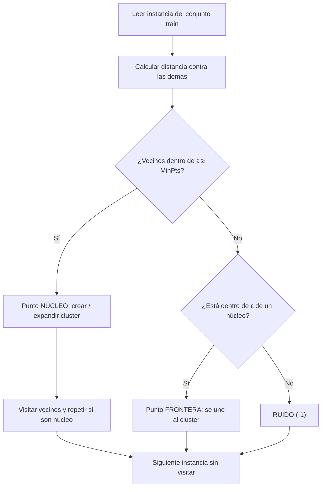
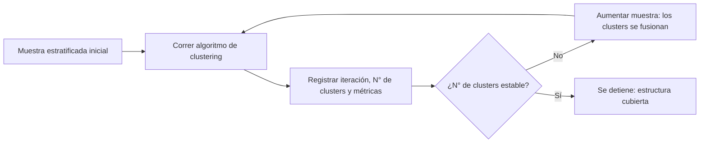

# Clustering por Densidad - Algoritmo DBSCAN, Parámetros Críticos y Métricas de Distancia
*Miércoles, 11 de noviembre de 2026*

## Conexiones
- Nota anterior: [[20. Árboles de Decisión, Algoritmo ID3, Entropía de Shannon y Ganancia de Información]]
- Antecedente directo: [[12. Imputación Avanzada en Datos MCAR, Esfericidad y Clustering por Densidad (DBSCAN)]] (DBSCAN como alternativa cuando la prueba de esfericidad se rechaza) y [[11. Detección de Outliers Multivariados, EDA con Profiling, KNN y DBSCAN]] (ruido `-1`).

---

## Conceptos Clave
- Se inicia el bloque de **aprendizaje no supervisado** (Proyecto 2): ya no hay atributo clasificador, el algoritmo descubre los grupos.
- **DBSCAN** agrupa por **densidad**: una zona con suficientes instancias cercanas forma un cluster.
- Dos parámetros críticos: **ε** (radio de la vecindad) y **MinPts** (mínimo de instancias dentro de ε).
- Hay que elegir una **métrica de distancia** (euclidiana, Manhattan, Chebyshev...) y se hacen **muchas comparaciones de distancias**.
- Se forman **hiperesferas pequeñas y locales** que se encadenan; **no** se busca un único cluster global.
- **Salida:** una etiqueta de cluster por instancia (`0, 1, 2…`) o ruido (`-1`).
- **Calidad de clusters:** se **maximiza** la distancia **inter-cluster** (entre clusters) y se **minimiza** la distancia **intra-cluster** (entre elementos del mismo cluster).
- **Proceso incremental:** al crecer la muestra se registran las iteraciones y el número de clusters; estos se fusionan y en algún punto el número **se estabiliza**, indicando que el algoritmo ya cubre la estructura de los datos.
- **Detección de valores separados:** por distancias en el hiperespacio, DBSCAN aísla las instancias alejadas del resto; por eso es importante **identificar los tipos de puntos** (núcleo, frontera y ruido).
- **Evaluación de clusters:** hay que medir el **tamaño** y el **radio de densidad** de cada cluster y comprobar que estén **separados del resto** (en $\mathbb{R}^2$ se puede visualizar).
- **Sobreajuste vs. subajuste:** ε pequeño tiende al **sobreajuste** (clusters muy fragmentados) y ε grande al **subajuste** (clusters fusionados). Hay que **explorar hiperparámetros** (ε y $k$ = MinPts).

---

## 1. Idea General y Parámetros Críticos
DBSCAN (*Density-Based Spatial Clustering of Applications with Noise*) parte de una pregunta: *¿cuántas instancias queremos (o necesitamos) tener cerca para considerar que ahí existe un cluster?*

| Parámetro | Significado | Ejemplo de clase |
|:---:|:---|:---|
| **ε** (*epsilon*) | Radio de densidad: define la hiperesfera de vecindad alrededor de una instancia | Radio fijado de antemano |
| **MinPts** | Número mínimo de instancias (vecinos) dentro de ε para que exista un cluster | 5 vecinos |
| **Métrica $d$** | Forma de medir "qué tan cerca" están dos instancias | Euclidiana, Manhattan, Chebyshev |

> **Idea de clase:** una vez definidos estos parámetros críticos, queda fijada la "ideología" del algoritmo: *un grupo de vecinos (p. ej. 5 instancias) dentro de ε ya define un cluster*.

> **Ejemplo / Caso Práctico (la fiesta):** Vista desde arriba, ε es el metro de distancia que se considera "estar juntos" y MinPts = 5 es la gente mínima para decir que ahí hay un grupo platicando. Quien está solo y lejos de todos es ruido.

---

## 2. Funcionamiento del Algoritmo
1. Se **leen una por una** las instancias del conjunto de entrenamiento (*train*). La primera puede ser un punto de borde; es un dato de entrada, no hay etiqueta.
2. Para la instancia actual se calcula su **distancia contra todas las demás** con la métrica elegida.
3. Se **cuentan los vecinos** que caen dentro de ε (región frontera de la hiperesfera).
4. Se clasifica la instancia:
   - **Punto núcleo:** tiene al menos MinPts vecinos dentro de ε → nace (o se expande) un cluster.
   - **Punto frontera:** tiene menos de MinPts, pero cae dentro de ε de un núcleo → pertenece al cluster sin expandirlo.
   - **Ruido:** no es núcleo ni está cerca de uno → etiqueta `-1`.
5. Los vecinos que también son núcleo **propagan** el cluster (encadenamiento por densidad) hasta que no quedan más vecinos alcanzables.
6. Se toma la siguiente instancia sin visitar y se repite.

> **Aclaración del profesor:** se trata de formar **pequeñas hiperesferas locales**, no un cluster grandote. Los clusters grandes resultan solo de encadenar muchas vecindades densas.

---

## 3. Métricas de Distancia
Como hay que hacer muchas comparaciones, la métrica determina quién es vecino de quién y, por lo tanto, la forma de la vecindad.

| Métrica | Idea | Fórmula (2D) | Forma de la vecindad |
|:---|:---|:---|:---:|
| **Euclidiana** | Línea recta | $\sqrt{(x_1-x_2)^2+(y_1-y_2)^2}$ | Círculo / hiperesfera |
| **Manhattan** | Calles de una cuadrícula | $\lvert x_1-x_2\rvert+\lvert y_1-y_2\rvert$ | Rombo |
| **Chebyshev** | Mayor diferencia en una dimensión | $\max(\lvert x_1-x_2\rvert,\lvert y_1-y_2\rvert)$ | Cuadrado |

> **Ejemplo:** del punto $(0,0)$ al $(3,4)$: Euclidiana = 5, Manhattan = 7, Chebyshev = 4. Con el mismo ε, un punto puede ser vecino con una métrica y no serlo con otra.

> [!IMPORTANT]
> Antes de medir distancias hay que **escalar / normalizar** las variables (ver [[16. Dinámica del Hiperplano con Momento, Preprocesamiento para Redes, Sobreajuste y Partición de Datos]]); de lo contrario, la variable de mayor magnitud domina la distancia.

---

## 4. Entrada, Salida y Efecto de los Parámetros

| | Contenido |
|:---|:---|
| **Entrada** | Instancias del conjunto train (sin etiquetas), ε, MinPts y métrica |
| **Salida** | Los **clusters**: una etiqueta por instancia (`0, 1, 2…`) o ruido (`-1`) |

| Situación | Efecto |
|:---|:---|
| ε muy pequeño | Casi nada alcanza MinPts: todo es ruido |
| ε muy grande | Las vecindades se encadenan y todo se fusiona en **un único cluster global** |
| MinPts muy alto | Los clusters se rompen o desaparecen; más ruido y frontera |
| MinPts muy bajo | Se forman clusters con muy pocos puntos, sensibles al ruido |

> Ver la demo interactiva generada en la sesión: `dbscan_demo.html`.

---

### Sobreajuste y Subajuste según ε (Exploración de Hiperparámetros)
En clase se observó qué pasa al mover el radio, con la analogía de los conceptos de la nota [[16. Dinámica del Hiperplano con Momento, Preprocesamiento para Redes, Sobreajuste y Partición de Datos]]:

| Valor de ε | Comportamiento | Analogía |
|:---:|:---|:---:|
| **Pequeño** | Vecindades diminutas: clusters muy fragmentados y mucho ruido; el modelo se "pega" a los datos de entrenamiento | **Sobreajuste** |
| **Grande** | Las vecindades se encadenan y los grupos distintos se funden en uno; el modelo es demasiado general | **Subajuste** |

- Los hiperparámetros a definir son **ε** y **$k$** (número de vecinos, equivalente a MinPts). Con $k$ bajo, basta pocas instancias cercanas para declarar un cluster, por lo que se pueden formar **más clusters** (pequeños).
- Pregunta de clase: *¿cuántos vecinos hay que definir para considerar que una instancia tiene vecinos?* No hay un valor único; depende de los datos y se decide **explorando combinaciones** de ε y $k$, como en el *Grid Search* de la nota [[17. Metodología de Búsqueda de Topología, Cuellos de Botella y Transición de Capas en Redes Neuronales]].

> **Ejemplo:** probar ε ∈ {0.1, 0.3, 0.5, 1.0} con $k$ ∈ {3, 5, 10} y comparar para cada combinación el número de clusters y el porcentaje de ruido; una combinación que da 1 solo cluster indica subajuste y una que da casi todo ruido indica sobreajuste.

---

### Métricas para Evaluar los Clusters (Tamaño, Radio y Separación)
Al no haber etiquetas, el resultado se valida midiendo **qué tan compactos son los clusters y qué tan separados están entre sí**. En clase se planteó revisar qué métricas sirven para calcular el **tamaño de los clusters** y su **radio de densidad**; en un espacio de 2 dimensiones ($\mathbb{R}^2$) la combinación de valores de ε y $k$ determina si los grupos quedan **separados del resto**.

| Medida | Qué mide | Interpretación |
|:---|:---|:---|
| **Tamaño del cluster** | Número de instancias en cada cluster | Clusters diminutos sugieren sobreajuste; uno gigante, subajuste |
| **Porcentaje de ruido** | Instancias con etiqueta `-1` sobre el total | Mucho ruido indica ε pequeño o $k$ alto |
| **Radio / diámetro del cluster** | Distancia del centro (o de las instancias más alejadas) al borde del cluster | Debe ser coherente con ε; un radio enorme indica encadenamiento |
| **Distancia intra-cluster (cohesión)** | Distancia entre elementos del **mismo** cluster | **Se quiere minimizar**: cluster más compacto |
| **Distancia inter-cluster (separación)** | Distancia entre clusters **distintos** | **Se quiere maximizar**: grupos mejor separados |

> **Complemento (no mencionado explícitamente en clase):** existen índices que combinan cohesión y separación en un solo número, como el **coeficiente de silueta** (de $-1$ a $1$; cercano a $1$ es mejor) y el **índice de Davies-Bouldin** (más bajo es mejor). Sirven para comparar las combinaciones de ε y $k$ de la exploración de hiperparámetros. Hay que confirmar con el profesor cuáles se usarán en el curso.

> **Ejemplo en $\mathbb{R}^2$:** al graficar las instancias y colorear por cluster, una buena combinación muestra nubes de color claramente separadas por zonas vacías; una mala muestra colores mezclados o un solo color que cubre todo.

---

### Tipos de Puntos: por Qué Importa Identificarlos
Al medir distancias en el **hiperespacio** (el espacio de $D$ dimensiones formado por los atributos), DBSCAN detecta los **valores separados** del resto sin necesidad de etiquetas. La clasificación de cada instancia en un tipo de punto es una parte central del resultado:

| Tipo de punto | Condición | Qué significa / para qué sirve |
|:---|:---|:---|
| **Núcleo** | $\geq k$ vecinos dentro de ε | Zona densa: es el "corazón" del cluster y quien lo expande |
| **Frontera** | $< k$ vecinos, pero dentro de ε de un núcleo | Borde del cluster: pertenece al grupo, pero es menos representativo |
| **Ruido / valor separado** | Ni núcleo ni cercano a uno (`-1`) | **Outlier**: instancia aislada en una región de baja densidad |

- Los **núcleos** definen la forma y el tamaño de los clusters.
- Los **puntos frontera** explican por qué dos clusters pueden quedar casi pegados.
- El **ruido** es el detector nativo de anomalías (conecta con el score de distancia de KNN de la nota [[11. Detección de Outliers Multivariados, EDA con Profiling, KNN y DBSCAN]]); según el problema se descarta, se investiga (fraude, error de captura) o se imputa.

> **Ejemplo:** en un conjunto de clientes con (edad, gasto mensual), una persona de 25 años con un gasto 50 veces mayor al de todos los demás no tiene vecinos dentro de ε: queda como ruido y se marca como cliente atípico.

---

### Criterio de Calidad: Distancia Inter-cluster vs. Intra-cluster
$$\text{Buen clustering} \iff \underbrace{d_{\text{inter}}}_{\text{maximizar}} \gg \underbrace{d_{\text{intra}}}_{\text{minimizar}}$$

- **Intra-cluster:** qué tan cerca están entre sí los elementos de un mismo cluster. Se **minimiza**.
- **Inter-cluster:** qué tan lejos quedan unos clusters de otros. Se **maximiza**.
- El coeficiente de silueta y Davies-Bouldin (complemento) resumen justo esta relación en un solo número.

> **Ejemplo:** dos grupos de clientes con centros a distancia 10 y dispersión interna de 1 están muy bien separados ($d_{inter}=10 \gg d_{intra}=1$). Si la dispersión interna fuera 8, los grupos casi se traslapan.

### Proceso Incremental y Estabilización del Número de Clusters
Aplicando el muestreo progresivo de la nota [[8. Muestreo Progresivo en Poblaciones No Normales y Desbalanceadas]] al clustering:
1. En cada **iteración** crece la muestra (estratificada) y se vuelve a correr el algoritmo.
2. Se registra el **número de clusters** obtenido y las métricas de calidad.
3. Al crecer la muestra, los clusters pequeños se **fusionan** con los cercanos y el número de clusters va cambiando.
4. En algún punto el número de clusters **se estaciona** (se estabiliza): el algoritmo ya cubre la estructura de los datos y no hace falta más muestra.

---

## 5. Aplicaciones y Limitaciones
- **Aplicaciones:** detección de anomalías y fraude, segmentación de clientes, datos geográficos, limpieza de outliers e imputación por clustering (notas 10 a 12).
- **Ventajas frente a K-Means:** no requiere fijar el número de clusters, detecta formas arbitrarias y aísla el ruido.
- **Limitaciones:** sensible a ε y MinPts; falla con densidades muy distintas entre clusters; las distancias pierden sentido en muchas dimensiones; costo alto por el cálculo de distancias entre todos los pares.

---

## Tareas Asignadas
- [ ] **Tarea de clase:** realizar una exploración de hiperparámetros de DBSCAN, probando distintas combinaciones de ε y $k$ (vecinos mínimos / MinPts) y observando cuántos clusters y cuánto ruido resultan en cada caso (identificar cuándo hay sobreajuste y cuándo subajuste), midiendo el tamaño y el radio de los clusters y su separación respecto al resto. Fecha de entrega por confirmar. 🏷️ #minería_de_datos
